# audit (kind defects) flow map

Generated by `node tools/gen-flows.mjs audit-defects`. **Do not hand-edit.**
Every node and edge below was *observed*: the scenarios in `tools/flows/` run the real engine
under the test harness with scripted agent returns, so this is what a run does rather than what
it might do. `node tools/gen-flows.mjs --check` fails the gate while this file is stale.

```mermaid
%%{init: {"flowchart": {"nodeSpacing": 80, "rankSpacing": 200}}}%%
flowchart TD
  S0(["args"])
  a1["review · opus<br/>×2 concurrent"]
  a2["verify · opus<br/>×2 concurrent"]
  t1(["inventory written (the clean unit never reached verify)"])
  t2(["no inventory (a reviewer died: unit reported in failed, re-review it)"])
  t3(["no inventory (the findings are on no confirmed file: unit reported in failed, re-review it)"])
  t4(["inventory written (both lenses merged behind one verifier)"])
  x1[/"throw: Invalid args JSON"/]
  x2[/"throw: Invalid args.kind"/]
  x3[/"throw: Wrong kind for ..."/]
  x4[/"throw: args must include at least { runId, root, target, ... }"/]
  x5[/"throw: args.root is required"/]
  x6[/"throw: args.target.repo is required"/]
  x7[/"throw: reviewSeverity #quot;...#quot; is not one of low#124;medium#124;high#124;critical"/]
  x8[/"throw: Invalid args.changePolicy"/]
  x9[/"throw: Invalid role map"/]
  x10[/"throw: Unknown role key in a role map"/]
  x11[/"throw: Illegal role value in a role map"/]
  x12[/"throw: Invalid agentTypes arg"/]
  x13[/"throw: Invalid notes arg"/]
  x14[/"throw: Invalid args.conventionFiles"/]
  x15[/"throw: args.notes.dir is inside the target repo"/]
  x16[/"throw: review requires a non-empty args.units array"/]
  x17[/"throw: Issue file collision"/]
  x18[/"throw: Plan id collision"/]
  x19[/"throw: A user request was relayed into the context of the reviewer for ... ahead of its task"/]
  S0 --> a1
  S0 --> x1
  S0 --> x2
  S0 --> x3
  S0 --> x4
  S0 --> x5
  S0 --> x6
  S0 --> x7
  S0 --> x8
  S0 --> x9
  S0 --> x10
  S0 --> x11
  S0 --> x12
  S0 --> x13
  S0 --> x14
  S0 --> x15
  S0 --> x16
  S0 --> x17
  S0 --> x18
  a1 -.->|"L1 ×2"| a1
  a1 --> a2
  a1 --> t1
  a1 --> t2
  a1 --> t3
  a1 --> x19
  a2 --> t1
  a2 --> t4
```

## Phases

| Phase | What happens |
|---|---|
| Review | kind defects. Reviewer finds production defects in ONE bounded unit (units run concurrently, read-only) and writes them, with the evidence for each, to reviews/&lt;unit&gt;-&lt;lens&gt;.md, returning only their count; when it finds nothing it writes the clean issues/&lt;unit&gt;.md marker itself. |
| Verify | kind defects: spawned ONLY for units with findings, one per unit. It reads the review files by path, confirms each finding against real code, corrects severity, checks the Fix line it writes against the code it changes, routes via the decision matrix, and WRITES runs/&lt;runId&gt;/issues/&lt;unit&gt;.md verbatim (the inventory), returning a slim verdict index. kind enhancements: spawned ONLY for lenses with candidates, bin-packed: lenses join one verify unit up to a candidate cap, and a lens never splits across units. Each verifier reads its lenses' candidates files by path, re-checks each candidate against the real code, REJECTS anything the system already does / any unsubstantiated benefit / any nit / anything that is really a defect, scores impact x size, routes ADOPT \| ROADMAP \| NEEDS_USER \| REJECT, and WRITES proposals/&lt;lens&gt;.md verbatim for each of its lenses. |

## Loops

| Loop | Agent | Repeats while |
|---|---|---|
| L1 | review | each unit is swept once per lens |

## Terminal states

| Terminal | Reached when | Source |
|---|---|---|
| inventory written (the clean unit never reached verify) | one unit is clean, the other has findings | declared |
| no inventory (a reviewer died: unit reported in failed, re-review it) | a reviewer dies (its unit is reported in failed, unmarked) | declared |
| no inventory (the findings are on no confirmed file: unit reported in failed, re-review it) | a reviewer reports findings but did not confirm writing its review file | declared |
| inventory written (both lenses merged behind one verifier) | each unit is swept once per lens | declared |
| throw: Invalid args JSON | args is a string that is not valid JSON | throw (line 39) |
| throw: Invalid args.kind | args.kind is outside defects \| enhancements | throw (line 46) |
| throw: Wrong kind for ... | a payload with no kind holds an arg only the enhancements kind reads | throw (line 56) |
| throw: args must include at least { runId, root, target, ... } | args carry no runId | throw (line 60) |
| throw: args.root is required | args.root is missing | throw (line 65) |
| throw: args.target.repo is required | args.target.repo is missing | throw (line 73) |
| throw: reviewSeverity "..." is not one of low\|medium\|high\|critical | args.reviewSeverity is not a known severity | throw (line 89) |
| throw: Invalid args.changePolicy | args.changePolicy is outside focused \| proactive | throw (line 95) |
| throw: Invalid role map | models is an array in place of an object | throw (line 149) |
| throw: Unknown role key in a role map | models carries a key outside review \| verify | throw (line 154) |
| throw: Illegal role value in a role map | models maps a role to a model outside opus \| sonnet \| haiku \| fable · efforts maps a role to a level outside low \| medium \| high \| xhigh \| max | throw (line 157) |
| throw: Invalid agentTypes arg | agentTypes is not an object, carries a key outside review \| verify, or maps one to a blank name | throw (line 171) |
| throw: Invalid notes arg | notes lacks dir or survey, or names a relative path | throw (line 191) |
| throw: Invalid args.conventionFiles | args.conventionFiles is not an array of non-empty paths | throw (line 212) |
| throw: args.notes.dir is inside the target repo | notes.dir lies inside target.repo | throw (line 266) |
| throw: review requires a non-empty args.units array | args.units is empty | throw (line 925) |
| throw: Issue file collision | two unit ids map to one issue file | throw (line 935) |
| throw: Plan id collision | two unit ids map to one plan id | throw (line 936) |
| throw: A user request was relayed into the context of the reviewer for ... ahead of its task | a reviewer reports a user request relayed into its context, so no verifier runs | throw (line 1064) |

## Coverage

24 scenarios · 2/3 roles · 19/26 throw sites · 0/0 halt statuses · 23 terminal states.

audit.mjs also runs the enhancements kind, drawn in FLOW-enhancements.md, so the roles and throw sites only that kind reaches are listed uncovered here. The suite checks coverage over both maps.

Uncovered roles: find.

Uncovered throw (line 115): args.minImpact must be one of ...
Uncovered throw (line 231): args.scope is required
Uncovered throw (line 237): args.target.repo is required when any args.scope path is relative
Uncovered throw (line 243): args.target.repo is required when any args.conventionFiles entry is relative
Uncovered throw (line 378): args.lenses is required
Uncovered throw (line 382): lens ids collide after slugging
Uncovered throw (line 1176): A user request was relayed into the context of the finder for ... ahead of its task
