# audit (kind enhancements) flow map

Generated by `node tools/gen-flows.mjs audit-enhancements`. **Do not hand-edit.**
Every node and edge below was *observed*: the scenarios in `tools/flows/` run the real engine
under the test harness with scripted agent returns, so this is what a run does rather than what
it might do. `node tools/gen-flows.mjs --check` fails the gate while this file is stale.

```mermaid
%%{init: {"flowchart": {"nodeSpacing": 80, "rankSpacing": 200}}}%%
flowchart TD
  S0(["args"])
  a1["verify · opus"]
  a2["find · opus<br/>×2 concurrent"]
  t1(["proposals written"])
  t2(["lens NOT audited (finder died, lens in failed at stage find)"])
  t3(["clean lens (the finder wrote the marker, verify skipped)"])
  t4(["lens NOT audited (candidates file not attested, lens in failed at stage find)"])
  t5(["lens NOT audited (no routable candidate id, lens in failed at stage find)"])
  t6(["lens NOT audited (no marker attested, lens in failed at stage find)"])
  x1[/"throw: Invalid args JSON"/]
  x2[/"throw: Wrong kind for ..."/]
  x3[/"throw: args must include at least { runId, root, target, ... }"/]
  x4[/"throw: args.root is required"/]
  x5[/"throw: args.minImpact must be one of ..."/]
  x6[/"throw: Invalid role map"/]
  x7[/"throw: Unknown role key in a role map"/]
  x8[/"throw: Illegal role value in a role map"/]
  x9[/"throw: Invalid agentTypes arg"/]
  x10[/"throw: Invalid notes arg"/]
  x11[/"throw: Invalid args.conventionFiles"/]
  x12[/"throw: args.scope is required"/]
  x13[/"throw: args.target.repo is required when any args.scope path is relative"/]
  x14[/"throw: args.target.repo is required when any args.conventionFiles entry is relative"/]
  x15[/"throw: args.lenses is required"/]
  x16[/"throw: lens ids collide after slugging"/]
  x17[/"throw: A user request was relayed into the context of the finder for ... ahead of its task"/]
  S0 --> a2
  S0 --> x1
  S0 --> x2
  S0 --> x3
  S0 --> x4
  S0 --> x5
  S0 --> x6
  S0 --> x7
  S0 --> x8
  S0 --> x9
  S0 --> x10
  S0 --> x11
  S0 --> x12
  S0 --> x13
  S0 --> x14
  S0 --> x15
  S0 --> x16
  a1 --> t1
  a2 --> a1
  a2 --> t2
  a2 --> t3
  a2 --> t4
  a2 --> t5
  a2 --> t6
  a2 --> x17
```

## Phases

| Phase | What happens |
|---|---|
| Find | kind enhancements. One finder per lens (CONCURRENT), each reading the WHOLE scope through its lens. Grounded candidates only: what the system does today (file:line) -&gt; what it would do instead -&gt; the concrete cost that removes, with the evidence for each, written to candidates/&lt;lens&gt;.md. The finder returns only the candidate ids. A lens that finds nothing writes its own clean proposals/&lt;lens&gt;.md marker. |
| Verify | kind defects: spawned ONLY for units with findings, one per unit. It reads the review files by path, confirms each finding against real code, corrects severity, checks the Fix line it writes against the code it changes, routes via the decision matrix, and WRITES runs/&lt;runId&gt;/issues/&lt;unit&gt;.md verbatim (the inventory), returning a slim verdict index. kind enhancements: spawned ONLY for lenses with candidates, bin-packed: lenses join one verify unit up to a candidate cap, and a lens never splits across units. Each verifier reads its lenses' candidates files by path, re-checks each candidate against the real code, REJECTS anything the system already does / any unsubstantiated benefit / any nit / anything that is really a defect, scores impact x size, routes ADOPT \| ROADMAP \| NEEDS_USER \| REJECT, and WRITES proposals/&lt;lens&gt;.md verbatim for each of its lenses. |

## Terminal states

| Terminal | Reached when | Source |
|---|---|---|
| proposals written | both finders return candidates, and one packed verifier carries both lenses · a lens id slugs past 60 characters, so its file name is the 60-character cut | declared |
| lens NOT audited (finder died, lens in failed at stage find) | the finder dies (the lens is reported in failed at stage find) | declared |
| clean lens (the finder wrote the marker, verify skipped) | the finder returns no candidate and attests its marker | declared |
| lens NOT audited (candidates file not attested, lens in failed at stage find) | the finder returns candidate ids and does not attest its candidates file | declared |
| lens NOT audited (no routable candidate id, lens in failed at stage find) | every candidate id the finder returns does not read &lt;lens&gt;-&lt;n&gt; | declared |
| lens NOT audited (no marker attested, lens in failed at stage find) | the finder returns no candidate and does not attest its marker | declared |
| throw: Invalid args JSON | args is a string that is not valid JSON | throw (line 39) |
| throw: Wrong kind for ... | a kind: enhancements payload holds an arg only the defects kind reads | throw (line 56) |
| throw: args must include at least { runId, root, target, ... } | args carry no runId | throw (line 60) |
| throw: args.root is required | args.root is missing | throw (line 65) |
| throw: args.minImpact must be one of ... | args.minImpact names no rank | throw (line 115) |
| throw: Invalid role map | models is an array in place of an object | throw (line 149) |
| throw: Unknown role key in a role map | models carries a key outside find \| verify | throw (line 154) |
| throw: Illegal role value in a role map | models maps a role to a model outside opus \| sonnet \| haiku \| fable · efforts maps a role to a level outside low \| medium \| high \| xhigh \| max | throw (line 157) |
| throw: Invalid agentTypes arg | agentTypes is not an object, carries a key outside find \| verify, or maps one to a blank name | throw (line 171) |
| throw: Invalid notes arg | notes lacks dir or survey, or names a relative path | throw (line 191) |
| throw: Invalid args.conventionFiles | args.conventionFiles is not an array of non-empty paths | throw (line 212) |
| throw: args.scope is required | args.scope is empty | throw (line 229) |
| throw: args.target.repo is required when any args.scope path is relative | a scope path is relative and target.repo is missing | throw (line 235) |
| throw: args.target.repo is required when any args.conventionFiles entry is relative | a conventionFiles entry is relative and target.repo is missing | throw (line 241) |
| throw: args.lenses is required | args.lenses is empty | throw (line 376) |
| throw: lens ids collide after slugging | two lenses slug to one id · two lenses differ only past their 60th slug character | throw (line 380) |
| throw: A user request was relayed into the context of the finder for ... ahead of its task | a finder reports a user request relayed into its context, so no verifier runs | throw (line 1168) |

## Coverage

26 scenarios · 2/3 roles · 17/26 throw sites · 0/0 halt statuses · 23 terminal states.

audit.mjs also runs the defects kind, drawn in FLOW-defects.md, so the roles and throw sites only that kind reaches are listed uncovered here. The suite checks coverage over both maps.

Uncovered roles: review.

Uncovered throw (line 46): Invalid args.kind
Uncovered throw (line 73): args.target.repo is required
Uncovered throw (line 89): reviewSeverity "..." is not one of low\|medium\|high\|critical
Uncovered throw (line 95): Invalid args.changePolicy
Uncovered throw (line 264): args.notes.dir is inside the target repo
Uncovered throw (line 917): review requires a non-empty args.units array
Uncovered throw (line 927): Issue file collision
Uncovered throw (line 928): Plan id collision
Uncovered throw (line 1056): A user request was relayed into the context of the reviewer for ... ahead of its task
