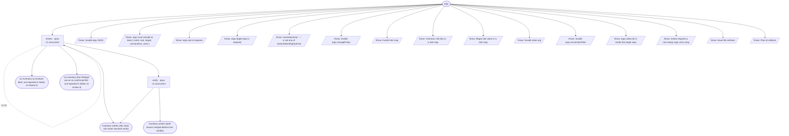

# debug/review flow map

Generated by `node tools/gen-flows.mjs review`. **Do not hand-edit.**
Every node and edge below was *observed*: the scenarios in `tools/flows/` run the real engine
under the test harness with scripted agent returns, so this is what a run does rather than what
it might do. `node tools/gen-flows.mjs --check` fails the gate while this file is stale.

## Phases

| Phase | What happens |
|---|---|
| Review | Reviewer finds production defects in ONE bounded unit (units run concurrently, read-only) and writes them, with the evidence for each, to reviews/&lt;unit&gt;-&lt;lens&gt;.md, returning only their count; when it finds nothing it writes the clean issues/&lt;unit&gt;.md marker itself. |
| Verify | Spawned ONLY for units with findings: reads the review files by path, confirms each finding against real code, corrects severity, checks the Fix line it writes against the code it changes, routes via the decision matrix, and WRITES runs/&lt;runId&gt;/issues/&lt;unit&gt;.md verbatim (the inventory). Returns a slim verdict index. |

## Loops

| Loop | Agent | Repeats while |
|---|---|---|
| L1 | review | each unit is swept once per lens |

## Terminal states

| Terminal | Reached when | Source |
|---|---|---|
| inventory written (the clean unit never reached verify) | one unit is clean, the other has findings | declared |
| no inventory (a reviewer died: unit reported in failed, re-review it) | a reviewer dies (its unit is reported in failed, unmarked) | declared |
| no inventory (the findings are on no confirmed file: unit reported in failed, re-review it) | a reviewer reports findings but did not confirm writing its review file | declared |
| inventory written (both lenses merged behind one verifier) | each unit is swept once per lens | declared |
| throw: Invalid args JSON | args is a string that is not valid JSON | throw (line 24) |
| throw: args must include at least { runId, root, target, conventions, units } | args carry no runId | throw (line 27) |
| throw: args.root is required | args.root is missing | throw (line 32) |
| throw: args.target.repo is required | args.target.repo is missing | throw (line 38) |
| throw: reviewSeverity "..." is not one of low\|medium\|high\|critical | args.reviewSeverity is not a known severity | throw (line 54) |
| throw: Invalid args.changePolicy | args.changePolicy is outside focused \| proactive | throw (line 60) |
| throw: Invalid role map | models is an array in place of an object | throw (line 134) |
| throw: Unknown role key in a role map | models carries a key outside review \| verify | throw (line 139) |
| throw: Illegal role value in a role map | models maps a role to a model outside opus \| sonnet \| haiku \| fable · efforts maps a role to a level outside low \| medium \| high \| xhigh \| max | throw (line 142) |
| throw: Invalid notes arg | notes lacks dir or survey, or names a relative path | throw (line 163) |
| throw: Invalid args.conventionFiles | args.conventionFiles is not an array of non-empty paths | throw (line 183) |
| throw: args.notes.dir is inside the target repo | notes.dir lies inside target.repo | throw (line 202) |
| throw: review requires a non-empty args.units array | args.units is empty | throw (line 508) |
| throw: Issue file collision | two unit ids map to one issue file | throw (line 518) |
| throw: Plan id collision | two unit ids map to one plan id | throw (line 519) |

## Coverage

20 scenarios · 2/2 roles · 15/15 throw sites · 0/0 halt statuses · 19 terminal states.
