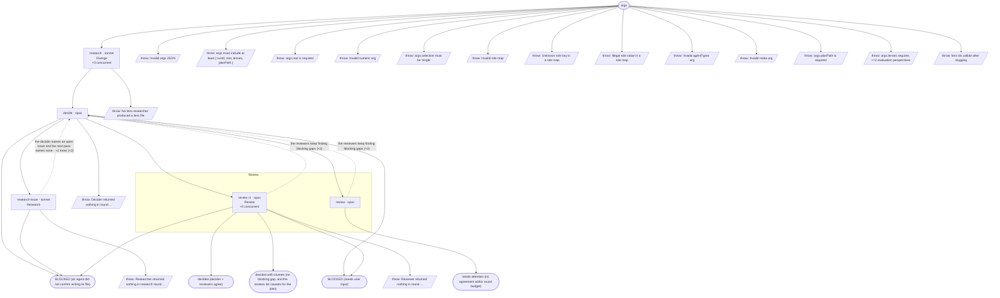

# decide-cycle flow map

Generated by `node tools/gen-flows.mjs decide`. **Do not hand-edit.**
Every node and edge below was *observed*: the scenarios in `tools/flows/` run the real engine
under the test harness with scripted agent returns, so this is what a run does rather than what
it might do. `node tools/gen-flows.mjs --check` fails the gate while this file is stale.

## Phases

| Phase | What happens |
|---|---|
| Diverge | One researcher per lens (CONCURRENT). Each reads the requirements (verbatim) + its lens, generates 2-4 options, gathers cited evidence for them, scores them under its lens, recommends one, and writes lenses/&lt;lens&gt;.md. Returns a thin index. |
| Decide | The decider reads the requirements + every lens file (+ the research files of the latest research round, + every review file of the previous review round), combines the best elements, builds a GLOBAL weighted decision matrix: musts pass/fail, wants met / partly met / missed, every cell citing its evidence or marked own judgment. It picks the winner, writes decision-rN.md with an Open issues section and a Checks for the user section, and returns the choice + the open issue slugs. |
| Research | One researcher per open issue (CONCURRENT). Each reads the requirements, the issue in the decision file and the files the decider names for it, searches with the tools it has, and writes research/r&lt;N&gt;-&lt;slug&gt;.md with its findings cited, or a check for the user when no agent can settle it. Returns whether it found new evidence. The decider then runs again. Research stops on covered (no open issue), saturated (two research rounds in a row with no new evidence) or cap (maxResearchRounds). |
| Review | NON-BLIND adversarial reviewers read the decision + requirements + lens and research files. Round 1 runs three focused reviewers CONCURRENTLY (single: choice, requirements, design; ranked: order, requirements, combine), each writing decision-review-r1-&lt;focus&gt;.md. Each later round runs one verifier that reads every review file of the previous round, checks each blocking gap was closed or rebutted, judges every changed passage, and writes decision-review-rN.md. Every gap is BLOCKING (non-negotiable violation, correctness defect, wrong choice, missed option) or a CAVEAT. No blocking gap ends the loop; blocking gaps drive another Decide round. |

## Terminal states

| Terminal | Reached when | Source |
|---|---|---|
| decided (decider + reviewers agree) | every reviewer agrees: no blocking gap, no caveat · the decider names an open issue and the next pass names none · two research rounds in a row find no new evidence · every research round finds new evidence until maxResearchRounds is spent · one lens researcher produces no lens file | derived |
| decided with caveats (no blocking gap, and the reviews list caveats for the plan) | every reviewer agrees and one lists a caveat | derived |
| needs-attention (no agreement within round budget) | the reviewers keep finding blocking gaps | derived |
| BLOCKED (an agent did not confirm writing its file) | a researcher does not confirm writing its research file · the decider does not confirm writing its decision file · a reviewer does not confirm writing its review file | derived |
| BLOCKED (needs user input) | the decider hits a user-only call · a reviewer finds a requirement contradiction | derived |
| throw: Invalid args JSON | args is a string that is not valid JSON | throw (line 28) |
| throw: args must include at least { runId, root, lenses, planPath } | args carry no runId | throw (line 31) |
| throw: args.root is required | args.root is missing | throw (line 34) |
| throw: Invalid numeric arg | maxRounds is not a number | throw (line 46) |
| throw: args.selection must be 'single' | selection is neither single nor ranked | throw (line 65) |
| throw: Invalid role map | models is an array in place of an object | throw (line 81) |
| throw: Unknown role key in a role map | models carries a key outside research \| decide \| review | throw (line 86) |
| throw: Illegal role value in a role map | models maps a role to a model outside opus \| sonnet \| haiku \| fable · efforts maps a role to a level outside low \| medium \| high \| xhigh \| max | throw (line 89) |
| throw: Invalid agentTypes arg | agentTypes is not an object, carries a key outside research \| decide \| review, or maps one to a blank name | throw (line 103) |
| throw: Invalid notes arg | notes lacks dir or survey, or names a relative path | throw (line 120) |
| throw: args.planPath is required | args carry no planPath | throw (line 147) |
| throw: args.lenses requires &gt;=2 evaluation perspectives | fewer than two lenses | throw (line 159) |
| throw: lens ids collide after slugging | two lenses slug to one file | throw (line 163) |
| throw: No lens researcher produced a lens file | no lens researcher produced a lens file | throw (line 519) |
| throw: Decider returned nothing in round ... | the decider dies | throw (line 579) |
| throw: Researcher returned nothing in research round ... | a researcher of an open issue dies | throw (line 643) |
| throw: Reviewer returned nothing in round ... | a reviewer dies | throw (line 675) |

## Coverage

30 scenarios · 5/5 roles · 17/17 throw sites · 0/0 halt statuses · 22 terminal states.
