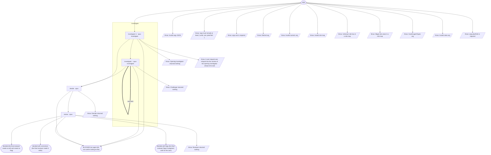

# decide-cycle flow map

Generated by `node tools/gen-flows.mjs decide`. **Do not hand-edit.**
Every node and edge below was *observed*: the scenarios in `tools/flows/` run the real engine
under the test harness with scripted agent returns, so this is what a run does rather than what
it might do. `node tools/gen-flows.mjs --check` fails the gate while this file is stale.

## Phases

| Phase | What happens |
|---|---|
| Investigate | A serial chain of at most maxInvestigators agents. The opening investigator reads the requirements (verbatim), searches the web, and the codebase when target.repo is passed, for every option worth weighing and writes investigations/i1.md: the options with their pros and cons, each defect it finds and does not fix written as a con, the assumptions the leader rests on, the standing and the directions searched. Each challenger k reads the requirements and every earlier investigation file in order, tries to replace the leader and to improve any option, a combination of options included, records each defect it comes across, and writes investigations/i&lt;k&gt;.md with its contributions. The chain stops at the first challenger that returns contributed false (dry) or after maxInvestigators agents (cap). |
| Decide | One decider reads the requirements and every investigation file, scores the options the files hold and the do-nothing option in one weighted matrix, every cell citing its source or marked own judgment, with each recorded defect no file fixes as a con, and writes decision.md: the ranking, the options, the matrix, the flip check, the options ruled out, the investigation facts its own research changed and the checks for the user, each combination the files do not hold among them as an untested combination. It builds no option and no combination. Returns the ranking index, the flip grade and the count of checks for the user. |
| Review | One final reviewer reads the requirements, every investigation file and decision.md. It first hunts defects: it tests what would be built under each of the three top-ranked options, checks that the parts of a combination fit together, and checks each contribution of the last investigation file (each option when that file is i1.md), since no later investigator read it. Each defect it shows with a concrete failure becomes a con or a ruled-out entry in decision.md and an entry under ## Defects in review.md, with the fix it would take but never written into the option. Then it opens the source behind every cell of the three top-ranked options, every must judgment and every ruled-out entry, reruns each saved script and testbed command they rest on, and recomputes every total. It corrects in decision.md each error a source, a rerun or the arithmetic proves, redoes the flip check when an edit moves rank 1 or rank 2, and writes review.md with its defects, its edits and its flags. Returns the counts, the ranking index and the flip grade after its edits. |

## Terminal states

| Terminal | Reached when | Source |
|---|---|---|
| decided (the final reviewer made no edit and raised no flag) | every challenger contributes, so the chain runs to maxInvestigators · challenger i2 contributes nothing, so the chain stops dry · maxInvestigators is 1, so the opening investigator is the whole chain | derived |
| decided with corrections (the final reviewer made N edits) | the final reviewer shows a defect or proves errors and corrects them | derived |
| decided with flags (the final reviewer flags N judgment calls for the user) | the final reviewer flags judgment calls it cannot prove wrong | derived |
| BLOCKED (an agent did not confirm writing its file) | the opening investigator does not confirm writing i1.md · a challenger does not confirm writing its investigation file · the decider does not confirm writing decision.md · the final reviewer does not confirm writing review.md | derived |
| throw: Invalid args JSON | args is a string that is not valid JSON | throw (line 25) |
| throw: args must include at least { runId, root, planPath } | args carry no runId | throw (line 28) |
| throw: args.root is required | args.root is missing | throw (line 31) |
| throw: Retired arg | args carry an arg the chain retired, such as lenses or checkTool | throw (line 46) |
| throw: Invalid numeric arg | maxInvestigators is not a number | throw (line 59) |
| throw: Invalid role map | models is an array in place of an object | throw (line 75) |
| throw: Unknown role key in a role map | models carries a key outside investigate \| decide \| review, such as the retired research or check | throw (line 80) |
| throw: Illegal role value in a role map | models maps a role to a model outside opus \| sonnet \| haiku \| fable · efforts maps a role to a level outside low \| medium \| high \| xhigh \| max | throw (line 83) |
| throw: Invalid agentTypes arg | agentTypes is not an object, carries a key outside investigate \| decide \| review, or maps one to a blank name | throw (line 97) |
| throw: Invalid notes arg | notes lacks dir or survey, or names a relative path | throw (line 115) |
| throw: args.planPath is required | args carry no planPath | throw (line 137) |
| throw: Opening investigator returned nothing | the opening investigator dies | throw (line 484) |
| throw: A user request was relayed into the context of the opening investigator ahead of its task | the opening investigator reports a user request relayed into its context | throw (line 487) |
| throw: Challenger returned nothing | a challenger dies | throw (line 496) |
| throw: Decider returned nothing | the decider dies | throw (line 517) |
| throw: Reviewer returned nothing | the final reviewer dies | throw (line 531) |

## Coverage

26 scenarios · 4/4 roles · 16/16 throw sites · 1/1 halt statuses · 20 terminal states.
