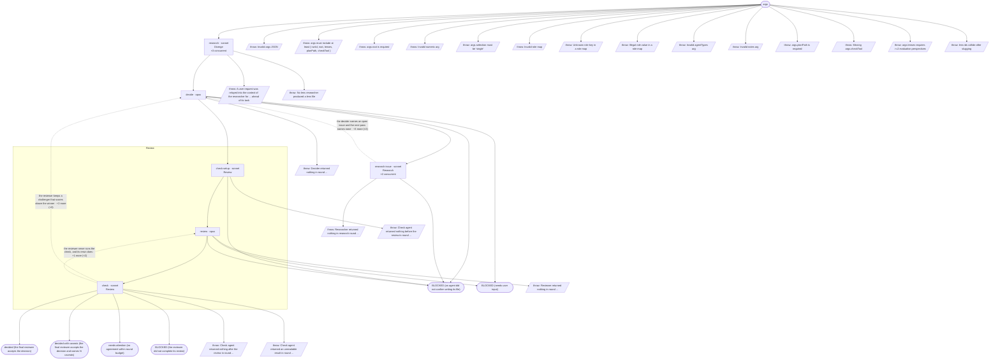

# decide-cycle flow map

Generated by `node tools/gen-flows.mjs decide`. **Do not hand-edit.**
Every node and edge below was *observed*: the scenarios in `tools/flows/` run the real engine
under the test harness with scripted agent returns, so this is what a run does rather than what
it might do. `node tools/gen-flows.mjs --check` fails the gate while this file is stale.

## Phases

| Phase | What happens |
|---|---|
| Diverge | One researcher per lens (CONCURRENT). Each reads the requirements (verbatim) + its lens, generates 2-4 options, gathers cited evidence for them, scores them under its lens, recommends one, and writes lenses/&lt;lens&gt;.md. Returns a thin index. |
| Decide | The decider reads the requirements + every lens file (+ the research files of the latest research round, + the previous review round's final review), combines the best elements, builds a GLOBAL weighted decision matrix: musts pass/fail, wants met / partly met / missed, every cell citing its evidence or marked own judgment. It picks the winner, writes decide/decision-rN.md with an Open issues section and a Checks for the user section, writes review/ledger-rN.md (the answer under review, the candidates and the sourced facts, no score or reasoning), and returns the choice + the open issue slugs. |
| Research | One researcher per open issue, for the first maxResearchers issues the decider lists (CONCURRENT). The rest are carried to the next decider pass. Each reads the requirements, the issue in the decision file and the files the decider names for it, searches with the tools it has, and writes research/r&lt;N&gt;-&lt;slug&gt;.md with its findings cited, or a check for the user when no agent can settle it. Returns whether it found new evidence. The decider then runs again. Research stops on covered (no open issue), saturated (two research rounds in a row with no new evidence) or cap (maxResearchRounds). |
| Review | A check agent writes the round's check spec and reveal text to locks/. ONE fresh reviewer reads the requirements + the ledger, scores every candidate blind and fills in review/review-rN.md, whose skeleton review-check.mjs writes, with its objections and verdict. Its next run of the check locks that file, writes the final file's skeleton and prints the reveal: read the decision file, sort each objection into withdrawn (by a quoted sourced fact), kept or downgraded, fill in the final file and run the check again. The check agent then runs review-check.mjs --verify: a matching lock gives the verdict from the kept count and names the caveat count, a mismatch falls back to the locked blind verdict, and a missing lock reruns the reviewer once, then blocks. A kept objection drives another Decide round. |

## Terminal states

| Terminal | Reached when | Source |
|---|---|---|
| decided (the final reviewer accepts the decision) | the reviewer keeps no objection · the reviewer keeps a challenger that scores above the winner · the reviewer keeps a non-negotiable the winner violates · the blind review changed after its lock, and its locked verdict is accept · the reviewer never runs the check, and its rerun does · the decider names an open issue and the next pass names none · two research rounds in a row find no new evidence · every research round finds new evidence until maxResearchRounds is spent · the decider lists more open issues than maxResearchers, so the rest are carried · one lens researcher produces no lens file | derived |
| decided with caveats (the final reviewer accepts the decision and names N caveats) | the reviewer keeps no objection and names caveats | derived |
| needs-attention (no agreement within round budget) | the reviewer keeps an objection every round | derived |
| BLOCKED (the reviewer did not complete its review) | the reviewer and its rerun never run the check | derived |
| BLOCKED (an agent did not confirm writing its file) | a researcher does not confirm writing its research file · the decider does not confirm writing its decision file and ledger · the check agent does not confirm writing the check spec and reveal text · the reviewer does not confirm writing its blind review | derived |
| BLOCKED (needs user input) | the decider hits a user-only call · the reviewer finds a requirement contradiction | derived |
| throw: Invalid args JSON | args is a string that is not valid JSON | throw (line 28) |
| throw: args must include at least { runId, root, lenses, planPath, checkTool } | args carry no runId | throw (line 31) |
| throw: args.root is required | args.root is missing | throw (line 34) |
| throw: Invalid numeric arg | maxRounds is not a number | throw (line 46) |
| throw: args.selection must be 'single' | selection is neither single nor ranked | throw (line 67) |
| throw: Invalid role map | models is an array in place of an object | throw (line 83) |
| throw: Unknown role key in a role map | models carries a key outside research \| decide \| review \| check | throw (line 88) |
| throw: Illegal role value in a role map | models maps a role to a model outside opus \| sonnet \| haiku \| fable · efforts maps a role to a level outside low \| medium \| high \| xhigh \| max | throw (line 91) |
| throw: Invalid agentTypes arg | agentTypes is not an object, carries a key outside research \| decide \| review \| check, or maps one to a blank name | throw (line 105) |
| throw: Invalid notes arg | notes lacks dir or survey, or names a relative path | throw (line 122) |
| throw: args.planPath is required | args carry no planPath | throw (line 160) |
| throw: Missing args.checkTool | args carry no checkTool | throw (line 165) |
| throw: args.lenses requires &gt;=2 evaluation perspectives | fewer than two lenses | throw (line 176) |
| throw: lens ids collide after slugging | two lenses slug to one file | throw (line 180) |
| throw: A user request was relayed into the context of the researcher for ... ahead of its task | a lens researcher reports a user request relayed into its context | throw (line 585) |
| throw: No lens researcher produced a lens file | no lens researcher produced a lens file | throw (line 589) |
| throw: Decider returned nothing in round ... | the decider dies | throw (line 642) |
| throw: Researcher returned nothing in research round ... | a researcher of an open issue dies | throw (line 711) |
| throw: Check agent returned nothing before the review in round ... | the check agent dies writing the check spec | throw (line 733) |
| throw: Reviewer returned nothing in round ... | the reviewer dies | throw (line 747) |
| throw: Check agent returned nothing after the review in round ... | the check agent dies running the check | throw (line 752) |
| throw: Check agent returned an unreadable result in round ... | the check agent returns an exit code or a last line the tool never prints | throw (line 781) |

## Coverage

42 scenarios · 6/6 roles · 22/22 throw sites · 3/3 halt statuses · 28 terminal states.
