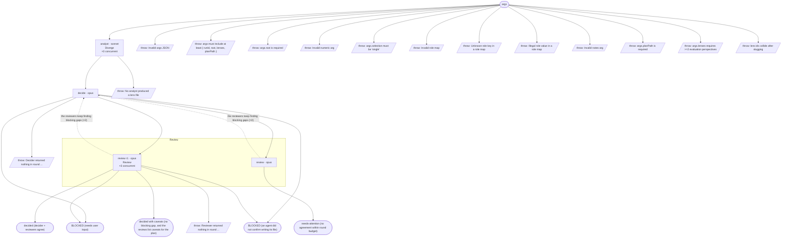

# decide-cycle flow map

Generated by `node tools/gen-flows.mjs decide`. **Do not hand-edit.**
Every node and edge below was *observed*: the scenarios in `tools/flows/` run the real engine
under the test harness with scripted agent returns, so this is what a run does rather than what
it might do. `node tools/gen-flows.mjs --check` fails the gate while this file is stale.

## Phases

| Phase | What happens |
|---|---|
| Diverge | One analyst per lens (CONCURRENT). Each reads the requirements (verbatim) + its lens, generates 2-4 options, scores them under its lens, recommends one, and writes lenses/&lt;lens&gt;.md. Returns a thin index. |
| Decide | The decider reads the requirements + every lens file (+ every review file of the previous round), combines the best elements, builds a GLOBAL weighted decision matrix enforcing the non-negotiables - every cell citing its lens evidence or marked own-judgment - picks the winner, and writes decision-rN.md. Returns the choice + a meets-all-requirements flag. |
| Review | NON-BLIND adversarial reviewers read the decision + requirements + lens files. Round 1 runs three focused reviewers CONCURRENTLY (single: choice, requirements, design; ranked: order, requirements, combine), each writing decision-review-r1-&lt;focus&gt;.md. Each later round runs one verifier that reads every review file of the previous round, checks each blocking gap was closed or rebutted, judges every changed passage, and writes decision-review-rN.md. Every gap is BLOCKING (non-negotiable violation, correctness defect, wrong choice, missed option) or a CAVEAT. No blocking gap ends the loop; blocking gaps drive another Decide round. |

## Terminal states

| Terminal | Reached when | Source |
|---|---|---|
| decided (decider + reviewers agree) | every reviewer agrees: no blocking gap, no caveat · one analyst produces no lens file | derived |
| decided with caveats (no blocking gap, and the reviews list caveats for the plan) | every reviewer agrees and one lists a caveat | derived |
| needs-attention (no agreement within round budget) | the reviewers keep finding blocking gaps | derived |
| BLOCKED (needs user input) | the decider hits a user-only call · a reviewer finds a requirement contradiction | derived |
| BLOCKED (an agent did not confirm writing its file) | the decider does not confirm writing its decision file · a reviewer does not confirm writing its review file | derived |
| throw: Invalid args JSON | args is a string that is not valid JSON | throw (line 27) |
| throw: args must include at least { runId, root, lenses, planPath } | args carry no runId | throw (line 30) |
| throw: args.root is required | args.root is missing | throw (line 33) |
| throw: Invalid numeric arg | maxRounds is not a number | throw (line 45) |
| throw: args.selection must be 'single' | selection is neither single nor ranked | throw (line 63) |
| throw: Invalid role map | models is an array in place of an object | throw (line 79) |
| throw: Unknown role key in a role map | models carries a key outside analyst \| decide \| review | throw (line 84) |
| throw: Illegal role value in a role map | models maps a role to a model outside opus \| sonnet \| haiku \| fable · efforts maps a role to a level outside low \| medium \| high \| xhigh \| max | throw (line 87) |
| throw: Invalid notes arg | notes lacks dir or survey, or names a relative path | throw (line 107) |
| throw: args.planPath is required | args carry no planPath | throw (line 131) |
| throw: args.lenses requires &gt;=2 evaluation perspectives | fewer than two lenses | throw (line 143) |
| throw: lens ids collide after slugging | two lenses slug to one file | throw (line 147) |
| throw: No analyst produced a lens file | no analyst produced a lens file | throw (line 439) |
| throw: Decider returned nothing in round ... | the decider dies | throw (line 479) |
| throw: Reviewer returned nothing in round ... | a reviewer dies | throw (line 520) |

## Coverage

24 scenarios · 4/4 roles · 15/15 throw sites · 0/0 halt statuses · 20 terminal states.
