# develop-cycle flow map

Generated by `node tools/gen-flows.mjs develop`. **Do not hand-edit.**
Every node and edge below was *observed*: the scenarios in `tools/flows/` run the real engine
under the test harness with scripted agent returns, so this is what a run does rather than what
it might do. `node tools/gen-flows.mjs --check` fails the gate while this file is stale.

```mermaid
%%{init: {"flowchart": {"nodeSpacing": 80, "rankSpacing": 200}}}%%
flowchart TD
  S0(["args"])
  subgraph p1["Develop"]
    a1["develop · opus"]
    a2["develop-closing · opus<br/>Develop"]
  end
  a3["quality · opus"]
  a4["acceptance · opus"]
  a5["park · opus"]
  a6["final-sweep · opus<br/>Sweep"]
  t1(["done (all blocks staged)"])
  t2(["partial slice complete (every selected block staged)"])
  t3(["nothing to run (no todo blocks)"])
  t4(["run complete (N block(s) parked)"])
  t5(["halted (a block was parked - its work is saved to a patch; the blocks after it were not attempted)"])
  t6(["run complete (N block(s) blocked)"])
  t7(["halted (a fix block closed no issue - every entry was skipped, and the ordered run stopped there)"])
  t8(["BLOCKED (a block passed but was not staged)"])
  t9(["BLOCKED (a block staged while self-reporting a regression)"])
  t10(["BLOCKED (a block passed but flagged a regression and was not staged - its work is parked)"])
  t11(["BLOCKED (acceptance failed a block but staged it)"])
  t12(["BLOCKED (a reviewer failed a block without confirming its review file)"])
  t13(["BLOCKED (the developer did not confirm its work stayed out of the staged index, which neither reviewer reads)"])
  t14(["BLOCKED (an agent could not obtain its plan - nothing was built from a guess)"])
  t15(["BLOCKED (an agent returned nothing - it was skipped or died; its work is parked)"])
  t16(["BLOCKED (working tree was not clean - nothing was built)"])
  t17(["BLOCKED (needs user input)"])
  t18(["BLOCKED (a parked block left the tree unsafe)"])
  t19(["stopped on token budget (fewer tokens remain than minPlanBudget)"])
  t20(["stopped on the runtime log line cap (no room is left for a status line inside the log lines Claude Code keeps)"])
  x1[/"throw: Invalid args JSON"/]
  x2[/"throw: args.plans must be a NON-EMPTY array of { id, planPath, mode, gate, status } entries"/]
  x3[/"throw: args must include at least { runId, root, target, gates, backlogDir, plans:[{id, planPath, mode, gate, status}] }"/]
  x4[/"throw: args.root is required"/]
  x5[/"throw: args.target.repo is required"/]
  x6[/"throw: Invalid numeric arg"/]
  x7[/"throw: Invalid args.changePolicy"/]
  x8[/"throw: args.reviewSeverity is retired"/]
  x9[/"throw: args.startAt is retired"/]
  x10[/"throw: The top-level args.planPath is retired"/]
  x11[/"throw: args.plans[].planContext is retired"/]
  x12[/"throw: Missing or relative args.backlogDir"/]
  x13[/"throw: args.backlogDir is inside the target repo"/]
  x14[/"throw: Invalid ordered key"/]
  x15[/"throw: Invalid suite key"/]
  x16[/"throw: Invalid sweep key"/]
  x17[/"throw: Invalid goal key"/]
  x18[/"throw: Missing goal key"/]
  x19[/"throw: plans entries at index [...] are not objects carrying a string id"/]
  x20[/"throw: plan id(s) [...] are not kebab slugs"/]
  x21[/"throw: plan mode(s) [...] are not one of feature #124; section #124; fix"/]
  x22[/"throw: pass entries [...] are malformed"/]
  x23[/"throw: plan gate(s) [...] are not legal for their block's mode"/]
  x24[/"throw: plan model(s) [...] are not one of opus #124; sonnet"/]
  x25[/"throw: plan status(es) [...] are not one of todo #124; done #124; skip #124; parked #124; blocked"/]
  x26[/"throw: plans [...] carry no planPath"/]
  x27[/"throw: duplicate plan id(s) [...] in args.plans"/]
  x28[/"throw: args.gates.build is required"/]
  x29[/"throw: Invalid slice arg"/]
  x30[/"throw: args.runOnly ... matches no plan id"/]
  x31[/"throw: Invalid continueParked arg"/]
  x32[/"throw: Invalid continueParked id"/]
  x33[/"throw: args.gates.test is required when any block being built has gate:#quot;green#quot;"/]
  S0 --> a1
  S0 --> t3
  S0 --> x1
  S0 --> x2
  S0 --> x3
  S0 --> x4
  S0 --> x5
  S0 --> x6
  S0 --> x7
  S0 --> x8
  S0 --> x9
  S0 --> x10
  S0 --> x11
  S0 --> x12
  S0 --> x13
  S0 --> x14
  S0 --> x15
  S0 --> x16
  S0 --> x17
  S0 --> x18
  S0 --> x19
  S0 --> x20
  S0 --> x21
  S0 --> x22
  S0 --> x23
  S0 --> x24
  S0 --> x25
  S0 --> x26
  S0 --> x27
  S0 --> x28
  S0 --> x29
  S0 --> x30
  S0 --> x31
  S0 --> x32
  S0 --> x33
  a1 -.->|"L1 ×5"| a1
  a1 ==>|"next item"| a1
  a1 --> a2
  a1 --> a3
  a1 --> a4
  a1 --> a5
  a1 --> t7
  a1 --> t16
  a2 -.->|"a block parks and ordered is false · +5 more (×2)"| a4
  a2 --> a5
  a3 -.->|"the blind review finds defects · +1 more (×2)"| a1
  a3 --> a4
  a3 --> a5
  a4 ==> a1
  a4 -.->|"E1 ×5"| a1
  a4 --> a2
  a4 --> a5
  a4 --> a6
  a4 --> t1
  a4 --> t2
  a4 --> t4
  a4 --> t6
  a4 --> t8
  a4 --> t9
  a4 --> t19
  a4 --> t20
  a5 ==>|"next item"| a1
  a5 --> t4
  a5 --> t5
  a5 --> t10
  a5 --> t11
  a5 --> t12
  a5 --> t13
  a5 --> t14
  a5 --> t15
  a5 --> t17
  a5 --> t18
  a6 --> t1
```

## Phases

| Phase | What happens |
|---|---|
| Develop | Developer reads its own block (verbatim, via the plan-block command) + the latest review that flagged issues, and works within the run's changePolicy in six phases, in this order. PATTERNS follows the repo's existing patterns. BUILD builds the block, then runs the gate. In a round that answers a review, a feature or section block's BUILD routes each finding and gap in it through the decision matrix in place of the build, and a fix block's BUILD routes them beside its entry rules. HARDEN handles edge cases, failure messages, logging, a test per risky path and cleanup at every tier in the code its round added or changed. SIBLINGS covers each sibling path of a fix. SELF-REVIEW applies the blind reviewer's severity scale, reach step and checklist to the code its round changed or read, since each earlier round had its own self-review and each blind review judges the entire block diff. CLASSIFY answers four risk questions (systems, paths, critical code, assumptions) for each change its round made, writes risk-&lt;id&gt;-rN.md and returns review_needed, true when any change is not low risk. Each phase after BUILD re-runs the gate after its changes. It leaves changes UNSTAGED. Owns the decision matrix; halts only for a user-only decision. changePolicy sets the routing over three code zones: task code (the code its block's required changes add or change, plus in a fix block the sibling paths of each ACTIONABLE entry's root cause, apart from code its block's text excludes or another block owns), connected code (what a reach step from the task code finds, apart from code its block's text excludes or another block owns) and other code. Under both policies it hunts only task code, fixes every finding there at every tier, a defect the staged baseline already had included, and fixes each finding its diff introduces or exposes in connected code. Only a proactive feature or section block also fixes a defect the staged baseline already had in connected code that its diff neither introduces nor exposes, and only when that fix is low risk. Other code is never changed. A finding its diff introduces or exposes there is closed at its source in task or connected code, or escalated when only a change in other code closes it. It logs to DECISIONS.md, as a FOCUSED or PROACTIVE line, each fix of a defect the staged baseline already had that no requirement of its block names. Each real defect at low or above that the staged baseline already had and that its zone routing leaves unchanged, under rule 2 or as a sibling path, apart from one in code another block owns, goes to its block's file in the project's backlog folder (args.backlogDir), a fix-mode plan file a later run builds once the user triages it. A proactive developer also records there each cleanup outside task code that it noticed and did not make, such as a refactor or a nit. When a block's last allowed round ends without a passed acceptance, one more developer, the closing pass, makes each fix of the last review's findings and gaps that is low risk and records each one that is not as a backlog entry naming the fix, with no blind review after it. |
| Quality | BLIND pure-code critic: reads ONLY the unstaged diff (no plan, no spec, no goal), reports every finding the diff introduces or exposes at every tier, from critical down to nit, under both change policies, and writes quality-review-&lt;id&gt;-rN.md. Clean means no finding and no contested dismissal. Runs in a block's first round with a satisfied gate in a launch, and in a later round only when a round since the block's last blind review returned review_needed true or no boolean, or the previous acceptance verdict returned risk_misclassified. Otherwise the round goes from the developer straight to acceptance. Never runs on the closing pass. |
| Acceptance | Plan-aware gate: every acceptance criterion of THIS block met + reachable + the block gate satisfied + no regression + every risk answer of each round since the block's last blind review holds against the diff (a wrong or missing one returns risk_misclassified, so the next round gets a blind review). Writes acceptance-review-&lt;id&gt;-rN.md; on pass, STAGES that block (git add, never commit) - the accepted baseline advances. |
| Park | On a block that did not accept within its round budget, or one the developer escalated: SAVES its work to parked-&lt;id&gt;.patch, then clears it from the tree. A closing pass that recorded a backlog entry, or whose changes still owe a blind review, parks its block with the closing pass's work, and the park record names each recorded entry. An UNORDERED run continues past a budget park or a needs-user escalation; an ORDERED run, or any other escalation, stops. Nothing is destroyed - NEEDS-USER.md carries the restore command. |
| Sweep | Only when the plan file asks for it (sweep: goal-coverage) and every non-skip block is done: an independent agent re-greps the whole surface from the GOAL, runs the full gates, spot-checks the staged diff, writes SWEEP.md. Advisory - a dead sweep never halts. |

## Loops

| Loop | Agent | Repeats while |
|---|---|---|
| L1 | develop | the block gate is never green |

## Edges

| Edge | From | To | Taken when |
|---|---|---|---|
| E1 | acceptance | develop | acceptance finds gaps · a block parks and ordered is false · a block parks and ordered is true · park could not clear the tree · park reports saved=false with bytes on disk · the build is red after parking |

The thick unlabelled edge of each pair above is the next-item advance (the unit boundary).

## Terminal states

| Terminal | Reached when | Source |
|---|---|---|
| done (all blocks staged) | every block accepts and the sweep runs · the whole-goal sweep dies · sweep:none on a fully accepted run · the blind review finds defects · acceptance finds gaps · the developer judges every change since the last blind review low risk · a fix block fixes an issue and accepts · a packed pass of two fix blocks fixes its issues and accepts · every issue in a fix block is stale · continueParked names block-a and every block accepts · the last round fails and the closing pass makes only low-risk fixes | derived |
| partial slice complete (every selected block staged) | runOnly builds a subset of the blocks | derived |
| nothing to run (no todo blocks) | no block still has status todo | derived |
| run complete (N block(s) parked) | the block gate is never green · a block parks and ordered is false · the developer hits a user-only blocker in an unordered run · the closing pass records a backlog entry | derived |
| halted (a block was parked - its work is saved to a patch; the blocks after it were not attempted) | a block parks and ordered is true | derived |
| run complete (N block(s) blocked) | a fix block closes nothing and ordered is false | derived |
| halted (a fix block closed no issue - every entry was skipped, and the ordered run stopped there) | a fix block closes nothing and ordered is true | derived |
| BLOCKED (a block passed but was not staged) | acceptance passes without staging | derived |
| BLOCKED (a block staged while self-reporting a regression) | acceptance stages while reporting a regression | derived |
| BLOCKED (a block passed but flagged a regression and was not staged - its work is parked) | acceptance passes, flags a regression and stages nothing | derived |
| BLOCKED (acceptance failed a block but staged it) | acceptance fails a block but reports staged=true | derived |
| BLOCKED (a reviewer failed a block without confirming its review file) | quality finds defects but does not confirm writing its file · acceptance finds gaps but does not confirm writing its file | derived |
| BLOCKED (the developer did not confirm its work stayed out of the staged index, which neither reviewer reads) | the developer will not confirm its work stayed unstaged | derived |
| BLOCKED (an agent could not obtain its plan - nothing was built from a guess) | the developer reports plan_obtained=false · the acceptance verifier reports plan_obtained=false | derived |
| BLOCKED (an agent returned nothing - it was skipped or died; its work is parked) | the developer agent dies · the blind quality reviewer dies · the acceptance verifier dies | derived |
| BLOCKED (working tree was not clean - nothing was built) | the tree was not clean on round 1 | derived |
| BLOCKED (needs user input) | the developer hits a user-only blocker in an ordered run | derived |
| BLOCKED (a parked block left the tree unsafe) | park could not clear the tree · park reports saved=false with bytes on disk · the build is red after parking | derived |
| stopped on token budget (fewer tokens remain than minPlanBudget) | too few tokens left to start the next block | derived |
| stopped on the runtime log line cap (no room is left for a status line inside the log lines Claude Code keeps) | the next status line could fall past the runtime's 1,000 kept log lines · the last block's status lines fell past the runtime's 1,000 kept log lines | derived |
| throw: Invalid args JSON | args is a string that is not valid JSON | throw (line 23) |
| throw: args.plans must be a NON-EMPTY array of { id, planPath, mode, gate, status } entries | the plan-edit.mjs args object is nested under plans | throw (line 28) |
| throw: args must include at least { runId, root, target, gates, backlogDir, plans:[{id, planPath, mode, gate, status}] } | a plans array arrives with no runId | throw (line 31) |
| throw: args.root is required | args.root is missing | throw (line 35) |
| throw: args.target.repo is required | args.target.repo is missing | throw (line 39) |
| throw: Invalid numeric arg | maxRounds is not a number | throw (line 52) |
| throw: Invalid args.changePolicy | changePolicy is outside focused \| proactive | throw (line 63) |
| throw: args.reviewSeverity is retired | args carry reviewSeverity, any value | throw (line 68) |
| throw: args.startAt is retired | args carry a top-level startAt | throw (line 74) |
| throw: The top-level args.planPath is retired | args carry a top-level planPath | throw (line 77) |
| throw: args.plans[].planContext is retired | a plans row carries planContext | throw (line 83) |
| throw: Missing or relative args.backlogDir | backlogDir is missing or relative | throw (line 157) |
| throw: args.backlogDir is inside the target repo | backlogDir lies inside target.repo | throw (line 160) |
| throw: Invalid ordered key | ordered is the string "false" | throw (line 168) |
| throw: Invalid suite key | suite is outside green \| scoped | throw (line 173) |
| throw: Invalid sweep key | sweep is outside goal-coverage \| none | throw (line 178) |
| throw: Invalid goal key | goal is a number | throw (line 182) |
| throw: Missing goal key | sweep is goal-coverage and goal is empty | throw (line 187) |
| throw: plans entries at index [...] are not objects carrying a string id | a plans entry carries no id | throw (line 205) |
| throw: plan id(s) [...] are not kebab slugs | a plans entry id is not a kebab slug | throw (line 213) |
| throw: plan mode(s) [...] are not one of feature \| section \| fix | a block asks for an unknown mode | throw (line 220) |
| throw: pass entries [...] are malformed | a pass entry is not mode fix with two or more members | throw (line 231) |
| throw: plan gate(s) [...] are not legal for their block's mode | a feature block asks for gate red-baseline | throw (line 239) |
| throw: plan model(s) [...] are not one of opus \| sonnet | a block names a model outside opus \| sonnet | throw (line 247) |
| throw: plan status(es) [...] are not one of todo \| done \| skip \| parked \| blocked | a block names an unknown status | throw (line 255) |
| throw: plans [...] carry no planPath | a plans row carries no planPath | throw (line 271) |
| throw: duplicate plan id(s) [...] in args.plans | two plans entries share one id | throw (line 282) |
| throw: args.gates.build is required | args.gates.build is missing | throw (line 1458) |
| throw: Invalid slice arg | runOnly is a bare block id string | throw (line 1470) |
| throw: args.runOnly ... matches no plan id | runOnly holds an unknown block id | throw (line 1477) |
| throw: Invalid continueParked arg | continueParked is a bare block id string | throw (line 1484) |
| throw: Invalid continueParked id | continueParked holds an id this run does not build | throw (line 1490) |
| throw: args.gates.test is required when any block being built has gate:"green" | a todo block wants gate green with no test command | throw (line 1497) |

## Coverage

73 scenarios · 6/6 roles · 33/33 throw sites · 15/15 halt statuses · 53 terminal states.
