# develop-cycle flow map

Generated by `node tools/gen-flows.mjs develop`. **Do not hand-edit.**
Every node and edge below was *observed*: the scenarios in `tools/flows/` run the real engine
under the test harness with scripted agent returns, so this is what a run does rather than what
it might do. `node tools/gen-flows.mjs --check` fails the gate while this file is stale.

```mermaid
%%{init: {"flowchart": {"nodeSpacing": 80, "rankSpacing": 200}}}%%
flowchart TD
  S0(["args"])
  subgraph p1["Develop"]
    a1["develop · opus"]
    a2["develop-closing · opus<br/>Develop"]
  end
  a3["quality · opus"]
  a4["acceptance · opus"]
  a5["park · opus"]
  a6["final-sweep · opus<br/>Sweep"]
  t1(["done (all blocks staged)"])
  t2(["partial slice complete (every selected block staged)"])
  t3(["nothing to run (no todo blocks)"])
  t4(["run complete (N block(s) parked)"])
  t5(["halted (a block was parked - its work is saved on a branch that a backlog entry links; the blocks after it were not attempted)"])
  t6(["run complete (N block(s) blocked)"])
  t7(["halted (a fix block closed no issue - every entry was skipped, and the ordered run stopped there)"])
  t8(["BLOCKED (a block passed but was not staged)"])
  t9(["BLOCKED (a block staged while self-reporting a regression)"])
  t10(["BLOCKED (a block passed but flagged a regression and was not staged - its work is parked)"])
  t11(["BLOCKED (acceptance failed a block but staged it)"])
  t12(["BLOCKED (a reviewer failed a block without confirming its review file)"])
  t13(["BLOCKED (the staged index may hold work no reviewer read: the developer did not confirm its work stayed unstaged, or acceptance found the index changed outside acceptance)"])
  t14(["BLOCKED (an agent could not obtain its plan - nothing was built from a guess)"])
  t15(["BLOCKED (an agent returned nothing - it was skipped or died; its work is parked)"])
  t16(["BLOCKED (working tree was not clean - nothing was built)"])
  t17(["BLOCKED (needs user input)"])
  t18(["BLOCKED (a parked block left the tree unsafe)"])
  t19(["stopped on token budget (fewer tokens remain than minPlanBudget)"])
  t20(["stopped on the runtime log line cap (no room is left for a status line inside the log lines Claude Code keeps)"])
  t21(["halted (a fix block could not restore an unfinished branch, and the ordered run stopped there)"])
  t22(["done (all blocks committed)"])
  t23(["BLOCKED (the index held staged work - nothing was built)"])
  t24(["BLOCKED (a block passed but its commit did not land as asked)"])
  t25(["BLOCKED (acceptance failed a block but staged or committed it)"])
  t26(["BLOCKED (a user request was relayed into the developer, so the run was launched inside a user turn - nothing was reviewed)"])
  x1[/"throw: Invalid args JSON"/]
  x2[/"throw: args.plans must be a NON-EMPTY array of { id, planPath, mode, gate, status } entries"/]
  x3[/"throw: args must include at least { runId, root, target, gates, backlogDir, blockTool, plans:[{id, planPath, mode, gate, status}] }"/]
  x4[/"throw: args.root is required"/]
  x5[/"throw: args.target.repo is required"/]
  x6[/"throw: Invalid numeric arg"/]
  x7[/"throw: Invalid args.changePolicy"/]
  x8[/"throw: Invalid commit arg"/]
  x9[/"throw: args.reviewSeverity is retired"/]
  x10[/"throw: args.startAt is retired"/]
  x11[/"throw: The top-level args.planPath is retired"/]
  x12[/"throw: args.continueParked is retired"/]
  x13[/"throw: args.plans[].planContext is retired"/]
  x14[/"throw: Invalid role map"/]
  x15[/"throw: Unknown role key in a role map"/]
  x16[/"throw: Illegal role value in a role map"/]
  x17[/"throw: Invalid agentTypes arg"/]
  x18[/"throw: Invalid args.conventionFiles"/]
  x19[/"throw: Missing args.blockTool"/]
  x20[/"throw: Missing or relative args.backlogDir"/]
  x21[/"throw: args.backlogDir is inside the target repo"/]
  x22[/"throw: Invalid notes arg"/]
  x23[/"throw: args.notes.dir is inside the target repo"/]
  x24[/"throw: args.notes.dir is inside the run-state folder"/]
  x25[/"throw: Invalid ordered key"/]
  x26[/"throw: Invalid suite key"/]
  x27[/"throw: Invalid sweep key"/]
  x28[/"throw: Invalid goal key"/]
  x29[/"throw: Missing goal key"/]
  x30[/"throw: plans entries at index [...] are not objects carrying a string id"/]
  x31[/"throw: plan id(s) [...] are not kebab slugs"/]
  x32[/"throw: plan mode(s) [...] are not one of feature #124; section #124; fix"/]
  x33[/"throw: pass entries [...] are malformed"/]
  x34[/"throw: plan continues value(s) [...] are not a boolean"/]
  x35[/"throw: plan gate(s) [...] are not legal for their block's mode"/]
  x36[/"throw: plan model(s) [...] are not one of opus #124; sonnet #124; haiku #124; fable"/]
  x37[/"throw: plan effort(s) [...] are not one of low #124; medium #124; high #124; xhigh #124; max"/]
  x38[/"throw: plan status(es) [...] are not one of todo #124; done #124; skip #124; backlogged #124; parked #124; blocked"/]
  x39[/"throw: plan title(s) [...] are not one line of text"/]
  x40[/"throw: plans [...] carry no planPath"/]
  x41[/"throw: duplicate plan id(s) [...] in args.plans"/]
  x42[/"throw: args.gates.build is required"/]
  x43[/"throw: Invalid slice arg"/]
  x44[/"throw: args.runOnly ... matches no plan id"/]
  x45[/"throw: args.gates.test is required when any block being built has gate:#quot;green#quot;"/]
  S0 --> a1
  S0 --> t3
  S0 --> x1
  S0 --> x2
  S0 --> x3
  S0 --> x4
  S0 --> x5
  S0 --> x6
  S0 --> x7
  S0 --> x8
  S0 --> x9
  S0 --> x10
  S0 --> x11
  S0 --> x12
  S0 --> x13
  S0 --> x14
  S0 --> x15
  S0 --> x16
  S0 --> x17
  S0 --> x18
  S0 --> x19
  S0 --> x20
  S0 --> x21
  S0 --> x22
  S0 --> x23
  S0 --> x24
  S0 --> x25
  S0 --> x26
  S0 --> x27
  S0 --> x28
  S0 --> x29
  S0 --> x30
  S0 --> x31
  S0 --> x32
  S0 --> x33
  S0 --> x34
  S0 --> x35
  S0 --> x36
  S0 --> x37
  S0 --> x38
  S0 --> x39
  S0 --> x40
  S0 --> x41
  S0 --> x42
  S0 --> x43
  S0 --> x44
  S0 --> x45
  a1 -.->|"L1 ×5"| a1
  a1 ==>|"next item"| a1
  a1 --> a2
  a1 --> a3
  a1 --> a4
  a1 --> a5
  a1 --> t7
  a1 --> t16
  a1 --> t21
  a1 --> t23
  a1 --> t26
  a2 -.->|"the block gate is never green · +1 more (×2)"| a3
  a2 -.->|"a block parks and ordered is false · +6 more (×2)"| a4
  a3 -.->|"the blind review finds defects · +1 more (×2)"| a1
  a3 --> a4
  a3 --> a5
  a4 ==> a1
  a4 -.->|"E1 ×5"| a1
  a4 --> a2
  a4 --> a5
  a4 --> a6
  a4 --> t1
  a4 --> t2
  a4 --> t4
  a4 --> t6
  a4 --> t8
  a4 --> t9
  a4 --> t19
  a4 --> t20
  a4 --> t24
  a5 ==>|"next item"| a1
  a5 --> t4
  a5 --> t5
  a5 --> t10
  a5 --> t11
  a5 --> t12
  a5 --> t13
  a5 --> t14
  a5 --> t15
  a5 --> t17
  a5 --> t18
  a5 --> t25
  a6 --> t1
  a6 --> t22
```

## Phases

| Phase | What happens |
|---|---|
| Develop | Developer reads its own block (verbatim, via the plan-block command) + the latest review that flagged issues, and works within the run's changePolicy in six phases, in this order. PATTERNS follows the repo's existing patterns. BUILD builds the block, then runs the gate. In a round that answers a review, a feature or section block's BUILD routes each finding and gap in it through the decision matrix in place of the build, and a fix block's BUILD routes them beside its entry rules. HARDEN handles edge cases, failure messages, logging, a test per risky path and cleanup at every tier in the code its round added or changed. SIBLINGS covers each sibling path of a fix. SELF-REVIEW applies the blind reviewer's severity scale, reach step and checklist to the code its round changed or read, since each earlier round had its own self-review and each blind review judges the entire block diff. CLASSIFY answers four risk questions (systems, paths, critical code, assumptions) for each change its round made, writes risk-&lt;id&gt;-rN.md through tools/risk-check.mjs, which holds the file's format, reruns each search of its Sweep section in its plain and source-escaped forms and prints whether every answer is low risk. Its Sweep section holds a search for each changed name or phrase (a changed or removed one by its old wording, and by its new wording too when other text must repeat it) and, for an added, removed or renamed field of an agent's return schema, for each sentence that lists that agent's return fields. CLASSIFY returns review_needed from the tool's last line, true when any change is not low risk. Each phase after BUILD runs a targeted test while it works, the gate runs once more after the last phase that changed code, and a phase with nothing to do for its round's changes is skipped. It leaves changes UNSTAGED. Owns the decision matrix; halts only for a user-only decision. changePolicy sets the routing over three code zones: task code (the code its block's required changes add or change, plus in a fix block the sibling paths of each ACTIONABLE entry's root cause, apart from code its block's text excludes or another block owns, plus under proactive the code each pulled backlog entry's fix adds or changes), connected code (what a reach step from the task code finds, apart from code its block's text excludes or another block owns) and other code. Under both policies it hunts only task code, fixes every finding there at every tier, a defect the accepted baseline already had included, and fixes each finding its diff introduces or exposes in connected code. Only a feature or section block also fixes a defect the accepted baseline already had in connected code that its diff neither introduces nor exposes, and only when that fix is low risk. A proactive block fixes any such defect, and a focused block only one in a function or method that holds task code. Other code is never changed. A finding its diff introduces or exposes there is closed at its source in task or connected code, or escalated when only a change in other code closes it. It logs to DECISIONS.md, as a FOCUSED or PROACTIVE line, each fix of a defect the accepted baseline already had that no requirement of its block names. Each real defect at low or above that the accepted baseline already had and that its zone routing leaves unchanged, under rule 2 or as a sibling path, apart from one in code another block owns, goes to its block's file in the project's backlog folder (args.backlogDir), a fix-mode plan file a later run builds, the ACTIONABLE entries without triage and the rest once the user triages them. A proactive developer also records there each cleanup outside task code that it noticed and did not make, such as a nit. Under both policies it also records a feature or refactor outside its block's scope, and each choice it escalated and proceeded past by a default. It sets each entry's decision by one rule: ACTIONABLE for a defect or cleanup with one clear, small fix that changes no user-visible behavior, stored data or public contract, and NEEDS_USER for every other entry. When a block's last allowed round ends without a passed acceptance, one more developer, the closing pass, makes each fix of the last review's findings and gaps that is low risk and records each one that is not as a backlog entry naming the fix. No develop round follows it, and a blind review follows it only when its changes owe one. Under proactive, the round-1 developer also takes the ready backlog entries in the files its block changes that tools/plan-pull.mjs lists and that fit its capacity, marks each with a pulled line, lists them in PULLED-&lt;id&gt;.md and builds their fixes beside its block. |
| Quality | BLIND pure-code critic: reads ONLY the unstaged diff (no plan, no spec, no goal), reports every finding the diff introduces or exposes at every tier, from critical down to nit, under both change policies, and writes quality-review-&lt;id&gt;-rN.md. Clean means no finding and no contested dismissal. Runs in a block's first round with a satisfied gate in a launch, and in a later round only when a round since the block's last blind review returned review_needed true or no boolean, or the previous acceptance verdict returned risk_misclassified. Otherwise the round goes from the developer straight to acceptance. The closing pass gets one by the same rule, whatever its gate, and its findings go to the closing acceptance with no develop round between. |
| Acceptance | Plan-aware gate: every acceptance criterion of THIS block met + reachable + the block gate satisfied + no regression + every risk answer of each round since the block's last blind review or last clean risk audit holds against that round's own hunks and the latest such round's Sweep section lists each changed name or phrase, leaves out no hit a rerun of its search through tools/risk-check.mjs finds that the change left wrong, and has no unaffected hit that disagrees, and acceptance's own search of a changed or removed name or phrase by its old wording, and by its new wording too when other text must repeat it, finds no hit the change left wrong (a wrong or missing one returns risk_misclassified, so the next round gets a blind review). Writes acceptance-review-&lt;id&gt;-rN.md; on pass, STAGES that block (git add), and in commit mode (args.commit) commits it with the block's title as the entire message - the accepted baseline advances. Before it stages, it confirms the index still holds the tree this run last recorded for it, and a changed index halts the run and parks the block. The closing acceptance, which reads the closing blind review's file when one ran, sorts each gap as blocking (a regression, a red gate, an unmet criterion or unreachable change, in fix mode an ACTIONABLE entry whose root cause is open, a change made for an entry that is not ACTIONABLE or a change no FIXED claim accounts for, a defect at medium or higher the block's diff introduces, a wrong risk answer, a missing risk file or a sweep line that is missing, leaves out a hit the change left wrong, or disagrees with the change, in changes no blind review read, or a path that changed after its round's snapshot) or not blocking (every other gap). With no blocking gap it lands the block and appends each gap it leaves as one backlog entry. With a blocking gap, the block parks. Under proactive, it also judges each pulled backlog entry as fix acceptance judges an issue. A pulled entry's gap fails a round, and the closing acceptance reverts each pulled change it does not confirm before it stages the block. A pulled entry parks its block only when the gates fail after that revert, since the block's own work then depends on it. Each pulled entry syncs fixed or stale when its block lands and the last verdict confirmed it, else needs-attention, and loses its pulled line, apart from one whose fix a saved park's branch holds, which the park entry names. |
| Park | On a block that did not accept within its round budget, or one the developer escalated: SAVES its work as a commit on the branch aipg-unfinished/&lt;the block's backlog file id&gt;, built with git plumbing through a temporary index so the repo's index stays untouched and no commit hook runs, then clears it from the tree, and appends one backlog entry that links the branch and says why the block parked. The block's plan status becomes backlogged once the park clears the tree, keeps the build green and confirms its entry, after a halt that cannot leave the block's work staged or committed, for a block whose work a green fix block can build: not a red-baseline block, nor a build-only block in a run with no test gate. After such a halt, a fix block's park also takes as a parent the tip of each branch its round 1 restored whose every entry the developer's last report gave FIXED, or whose diff the working tree still holds, deletes that branch and syncs its entry stale. Every other park syncs blocked, and nextStep says whether the operator sets it backlogged or rebuilds it from todo. A closing acceptance that finds a blocking gap parks its block with the closing pass's work, and the park entry lists the blocking gaps first and names each backlog entry the closing pass listed. An UNORDERED run continues past a budget park or a needs-user escalation; an ORDERED run, or any other escalation, stops. Nothing is destroyed - a fix-mode block built from the entry restores the branch's work in its round 1. |
| Sweep | Only when the plan file asks for it (sweep: goal-coverage) and every non-skip block is done: an independent agent re-greps the whole surface from the GOAL, runs the full gates, spot-checks the staged diff, or in commit mode this launch's commits, writes SWEEP.md. Advisory - a dead sweep never halts. |

## Loops

| Loop | Agent | Repeats while |
|---|---|---|
| L1 | develop | the block gate is never green |

## Edges

| Edge | From | To | Taken when |
|---|---|---|---|
| E1 | acceptance | develop | acceptance finds gaps · a block parks and ordered is false · a block parks and ordered is true · changePolicy is proactive and acceptance fails a fix block with a pulled entry, then passes it · park could not clear the tree · park reports saved=false beside a commit id · the build is red after parking |

The thick unlabelled edge of each pair above is the next-item advance (the unit boundary).

## Terminal states

| Terminal | Reached when | Source |
|---|---|---|
| done (all blocks staged) | every block accepts and the sweep runs · changePolicy is proactive and a feature block accepts · the whole-goal sweep dies · sweep:none on a fully accepted run · the blind review finds defects · acceptance finds gaps · the developer judges every change since the last blind review low risk · the developer appends a line to its DISMISSED ledger and the block accepts · a fix block fixes an issue and accepts · changePolicy is proactive and a fix block fixes an issue and accepts · a fix block whose row carries continues false fixes an issue and accepts · changePolicy is proactive and a fix block whose row carries continues false fixes an issue and a pulled entry and accepts · changePolicy is proactive, a fix block whose row carries continues false reports pulled_results [] in round 1, fixes an issue and accepts · changePolicy is proactive and acceptance fails a fix block with a pulled entry, then passes it · a packed pass of two fix blocks fixes its issues and accepts · every issue in a fix block is stale · the last round fails and the closing acceptance finds no blocking gap · the closing pass judges a change not low risk and the closing acceptance finds no blocking gap | derived |
| partial slice complete (every selected block staged) | runOnly builds a subset of the blocks | derived |
| nothing to run (no todo blocks) | no block still has status todo | derived |
| run complete (N block(s) parked) | the block gate is never green · a block parks and ordered is false · the developer hits a user-only blocker in an unordered run · the closing acceptance finds a blocking gap | derived |
| halted (a block was parked - its work is saved on a branch that a backlog entry links; the blocks after it were not attempted) | a block parks and ordered is true | derived |
| run complete (N block(s) blocked) | a fix block closes nothing and ordered is false · a fix block's round-1 restore of an unfinished branch fails and ordered is false | derived |
| halted (a fix block closed no issue - every entry was skipped, and the ordered run stopped there) | a fix block closes nothing and ordered is true | derived |
| BLOCKED (a block passed but was not staged) | acceptance passes without staging | derived |
| BLOCKED (a block staged while self-reporting a regression) | acceptance stages while reporting a regression | derived |
| BLOCKED (a block passed but flagged a regression and was not staged - its work is parked) | acceptance passes, flags a regression and stages nothing | derived |
| BLOCKED (acceptance failed a block but staged it) | acceptance fails a block but reports staged=true | derived |
| BLOCKED (a reviewer failed a block without confirming its review file) | quality finds defects but does not confirm writing its file · acceptance finds gaps but does not confirm writing its file | derived |
| BLOCKED (the staged index may hold work no reviewer read: the developer did not confirm its work stayed unstaged, or acceptance found the index changed outside acceptance) | the developer will not confirm its work stayed unstaged · acceptance finds the staged index no longer holds the tree the run recorded | derived |
| BLOCKED (an agent could not obtain its plan - nothing was built from a guess) | the developer reports plan_obtained=false · the acceptance verifier reports plan_obtained=false | derived |
| BLOCKED (an agent returned nothing - it was skipped or died; its work is parked) | the developer agent dies · the blind quality reviewer dies · the acceptance verifier dies | derived |
| BLOCKED (working tree was not clean - nothing was built) | the tree was not clean on round 1 | derived |
| BLOCKED (needs user input) | the developer hits a user-only blocker in an ordered run | derived |
| BLOCKED (a parked block left the tree unsafe) | park could not clear the tree · park reports saved=false beside a commit id · the build is red after parking | derived |
| stopped on token budget (fewer tokens remain than minPlanBudget) | too few tokens left to start the next block | derived |
| stopped on the runtime log line cap (no room is left for a status line inside the log lines Claude Code keeps) | the next status line could fall past the runtime's 1,000 kept log lines · the last block's status lines fell past the runtime's 1,000 kept log lines | derived |
| halted (a fix block could not restore an unfinished branch, and the ordered run stopped there) | a fix block's round-1 restore of an unfinished branch fails and ordered is true | derived |
| done (all blocks committed) | commit is true and every block accepts and commits · commit is true and a fix block fixes an issue, accepts and commits | derived |
| BLOCKED (the index held staged work - nothing was built) | commit is true and files were staged before round 1 | derived |
| BLOCKED (a block passed but its commit did not land as asked) | acceptance passes but its commit does not land as asked | derived |
| BLOCKED (acceptance failed a block but staged or committed it) | acceptance fails a block but reports a commit | derived |
| BLOCKED (a user request was relayed into the developer, so the run was launched inside a user turn - nothing was reviewed) | the round-1 developer reports a user request relayed into its context | derived |
| throw: Invalid args JSON | args is a string that is not valid JSON | throw (line 23) |
| throw: args.plans must be a NON-EMPTY array of { id, planPath, mode, gate, status } entries | the plan-edit.mjs args object is nested under plans | throw (line 28) |
| throw: args must include at least { runId, root, target, gates, backlogDir, blockTool, plans:[{id, planPath, mode, gate, status}] } | a plans array arrives with no runId | throw (line 31) |
| throw: args.root is required | args.root is missing | throw (line 35) |
| throw: args.target.repo is required | args.target.repo is missing | throw (line 39) |
| throw: Invalid numeric arg | maxRounds is not a number | throw (line 52) |
| throw: Invalid args.changePolicy | changePolicy is outside focused \| proactive | throw (line 63) |
| throw: Invalid commit arg | commit is the string "true" | throw (line 68) |
| throw: args.reviewSeverity is retired | args carry reviewSeverity, any value | throw (line 73) |
| throw: args.startAt is retired | args carry a top-level startAt | throw (line 79) |
| throw: The top-level args.planPath is retired | args carry a top-level planPath | throw (line 82) |
| throw: args.continueParked is retired | args carry continueParked, any value | throw (line 85) |
| throw: args.plans[].planContext is retired | a plans row carries planContext | throw (line 91) |
| throw: Invalid role map | models is an array in place of an object | throw (line 103) |
| throw: Unknown role key in a role map | models carries a key outside the five role keys | throw (line 108) |
| throw: Illegal role value in a role map | models maps a role to a model outside opus \| sonnet \| haiku \| fable · efforts maps a role to a level outside low \| medium \| high \| xhigh \| max | throw (line 111) |
| throw: Invalid agentTypes arg | agentTypes is not an object, carries park or another key outside develop \| quality \| acceptance \| sweep, or maps one to a blank name | throw (line 128) |
| throw: Invalid args.conventionFiles | args.conventionFiles is not an array of non-empty paths | throw (line 185) |
| throw: Missing args.blockTool | blockTool is missing or blank | throw (line 210) |
| throw: Missing or relative args.backlogDir | backlogDir is missing or relative | throw (line 219) |
| throw: args.backlogDir is inside the target repo | backlogDir lies inside target.repo | throw (line 222) |
| throw: Invalid notes arg | notes lacks dir or survey, or names a relative path | throw (line 230) |
| throw: args.notes.dir is inside the target repo | notes.dir lies inside target.repo | throw (line 241) |
| throw: args.notes.dir is inside the run-state folder | notes.dir lies inside runs/&lt;runId&gt;/ | throw (line 245) |
| throw: Invalid ordered key | ordered is the string "false" | throw (line 270) |
| throw: Invalid suite key | suite is outside green \| scoped | throw (line 275) |
| throw: Invalid sweep key | sweep is outside goal-coverage \| none | throw (line 280) |
| throw: Invalid goal key | goal is a number | throw (line 284) |
| throw: Missing goal key | sweep is goal-coverage and goal is empty | throw (line 289) |
| throw: plans entries at index [...] are not objects carrying a string id | a plans entry carries no id | throw (line 308) |
| throw: plan id(s) [...] are not kebab slugs | a plans entry id is not a kebab slug | throw (line 316) |
| throw: plan mode(s) [...] are not one of feature \| section \| fix | a block asks for an unknown mode | throw (line 323) |
| throw: pass entries [...] are malformed | a pass entry is not mode fix with two or more members | throw (line 334) |
| throw: plan continues value(s) [...] are not a boolean | a fix row carries continues that is not true or false | throw (line 343) |
| throw: plan gate(s) [...] are not legal for their block's mode | a feature block asks for gate red-baseline | throw (line 351) |
| throw: plan model(s) [...] are not one of opus \| sonnet \| haiku \| fable | a block names a model outside opus \| sonnet \| haiku \| fable | throw (line 358) |
| throw: plan effort(s) [...] are not one of low \| medium \| high \| xhigh \| max | a block names an effort outside low \| medium \| high \| xhigh \| max | throw (line 364) |
| throw: plan status(es) [...] are not one of todo \| done \| skip \| backlogged \| parked \| blocked | a block names an unknown status | throw (line 372) |
| throw: plan title(s) [...] are not one line of text | commit is true and a block title spans two lines | throw (line 381) |
| throw: plans [...] carry no planPath | a plans row carries no planPath | throw (line 401) |
| throw: duplicate plan id(s) [...] in args.plans | two plans entries share one id | throw (line 412) |
| throw: args.gates.build is required | args.gates.build is missing | throw (line 2313) |
| throw: Invalid slice arg | runOnly is a bare block id string | throw (line 2324) |
| throw: args.runOnly ... matches no plan id | runOnly holds an unknown block id | throw (line 2331) |
| throw: args.gates.test is required when any block being built has gate:"green" | a todo block wants gate green with no test command | throw (line 2339) |

## Coverage

102 scenarios · 6/6 roles · 45/45 throw sites · 19/19 halt statuses · 71 terminal states.
