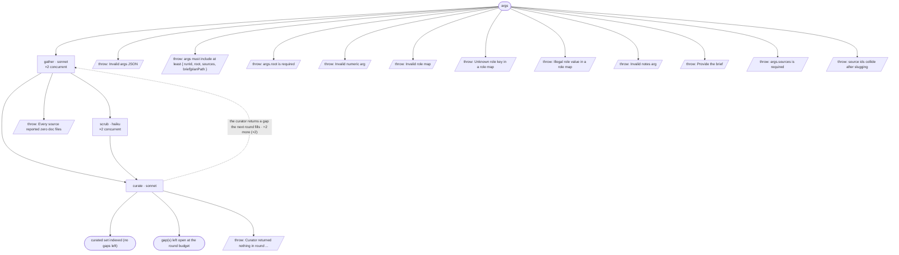

# docs-cycle flow map

Generated by `node tools/gen-flows.mjs docs`. **Do not hand-edit.**
Every node and edge below was *observed*: the scenarios in `tools/flows/` run the real engine
under the test harness with scripted agent returns, so this is what a run does rather than what
it might do. `node tools/gen-flows.mjs --check` fails the gate while this file is stale.

## Phases

| Phase | What happens |
|---|---|
| Gather | Round 1: one gatherer per source (CONCURRENT). Each copies its brief-relevant slice VERBATIM into &lt;outDir&gt;/&lt;source&gt;/ - one file per page/topic, each with a source header (URL or path, version, retrieval date). Subtraction at capture: skip nav, marketing, other versions, features the brief does not touch. Returns thin counts. A gap-fill round: ONE gatherer reads the Coverage-notes entry of every gap in INDEX.md by path, captures each gap into &lt;outDir&gt;/&lt;gap id&gt;/, and scrubs its own web captures under the scrub rules. |
| Scrub | Round 1 only: one scrubber per WEB source (pipelined off its gather - no barrier); repo and files sources skip it, their captures usually being markdown already with no HTML chrome. Cleans the source dir IN PLACE: removes capture junk (nav/menu fragments, cookie banners, feedback widgets, broken markup), fixes mangled markdown formatting, changes no words, keeps source headers. Unsure → keep; the curator judges relevance. |
| Curate | One curator reads the WHOLE set: organizes + splits at heading boundaries (text moves verbatim), deletes what the brief does not need (outDir is a dedicated, engine-owned folder for THIS doc set - anything it finds there that is neither a source-headed capture for this set (this or an earlier run) nor a curator-written file is left alone and reported), writes INDEX.md (one line per file + Coverage notes holding cross-source inconsistencies and one id-tagged entry per open gap, naming the file, the source and the reason), spot-checks each recapture against its source before deleting the file it replaces, then spot-checks up to fidelitySample files against the source cited in their own header. Gaps it returns as { kind, id } (missing coverage, or a recapture - wrong version, failed spot-check) spawn a bounded gap-fill Gather round (maxRounds). |

## Terminal states

| Terminal | Reached when | Source |
|---|---|---|
| curated set indexed (no gaps left) | every source captures files and the curator finds no gap · the curator returns a gap the next round fills · a gatherer dies mid-capture · the gap-fill gatherer dies · one source reports zero files · a repo source sits beside a web source | declared |
| gap(s) left open at the round budget | a gap is still open at maxRounds | declared |
| throw: Invalid args JSON | args is a string that is not valid JSON | throw (line 44) |
| throw: args must include at least { runId, root, sources, brief\|planPath } | args carry no runId | throw (line 47) |
| throw: args.root is required | args.root is missing | throw (line 50) |
| throw: Invalid numeric arg | maxRounds is not a number | throw (line 60) |
| throw: Invalid role map | models is an array in place of an object | throw (line 79) |
| throw: Unknown role key in a role map | models carries a key outside gather \| scrub \| curate | throw (line 84) |
| throw: Illegal role value in a role map | models maps a role to a model outside opus \| sonnet \| haiku \| fable · efforts maps a role to a level outside low \| medium \| high \| xhigh \| max | throw (line 87) |
| throw: Invalid notes arg | notes lacks dir or survey, or names a relative path | throw (line 107) |
| throw: Provide the brief | neither brief nor planPath | throw (line 130) |
| throw: args.sources is required | args.sources is empty | throw (line 143) |
| throw: source ids collide after slugging | two sources slug to one directory | throw (line 147) |
| throw: Every source reported zero doc files | no source captured anything in round 1 | throw (line 427) |
| throw: Curator returned nothing in round ... | the curator dies | throw (line 455) |

## Coverage

21 scenarios · 3/3 roles · 13/13 throw sites · 0/0 halt statuses · 15 terminal states.
