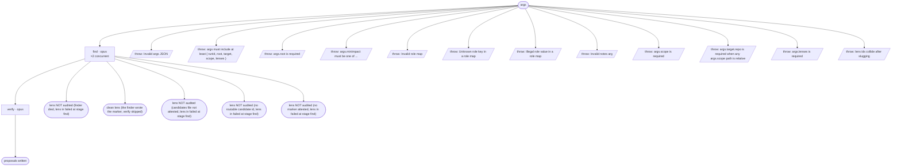

# enhance-cycle flow map

Generated by `node tools/gen-flows.mjs enhance`. **Do not hand-edit.**
Every node and edge below was *observed*: the scenarios in `tools/flows/` run the real engine
under the test harness with scripted agent returns, so this is what a run does rather than what
it might do. `node tools/gen-flows.mjs --check` fails the gate while this file is stale.

## Phases

| Phase | What happens |
|---|---|
| Find | One finder per lens (CONCURRENT), each reading the WHOLE scope through its lens. Grounded candidates only: what the system does today (file:line) -&gt; what it would do instead -&gt; the concrete cost that removes, with the evidence for each, written to candidates/&lt;lens&gt;.md. The finder returns only the candidate ids. A lens that finds nothing writes its own clean proposals/&lt;lens&gt;.md marker. |
| Verify | Spawned ONLY for lenses with candidates, bin-packed: lenses join one verify unit up to a candidate cap, and a lens never splits across units. Each verifier reads its lenses' candidates files by path, re-checks each candidate against the real code, REJECTS anything the system already does / any unsubstantiated benefit / any nit / anything that is really a defect, scores impact x size, routes ADOPT \| ROADMAP \| NEEDS_USER \| REJECT, and WRITES proposals/&lt;lens&gt;.md verbatim for each of its lenses. |

## Terminal states

| Terminal | Reached when | Source |
|---|---|---|
| proposals written | both finders return candidates, and one packed verifier carries both lenses | declared |
| lens NOT audited (finder died, lens in failed at stage find) | the finder dies (the lens is reported in failed at stage find) | declared |
| clean lens (the finder wrote the marker, verify skipped) | the finder returns no candidate and attests its marker | declared |
| lens NOT audited (candidates file not attested, lens in failed at stage find) | the finder returns candidate ids and does not attest its candidates file | declared |
| lens NOT audited (no routable candidate id, lens in failed at stage find) | every candidate id the finder returns does not read &lt;lens&gt;-&lt;n&gt; | declared |
| lens NOT audited (no marker attested, lens in failed at stage find) | the finder returns no candidate and does not attest its marker | declared |
| throw: Invalid args JSON | args is a string that is not valid JSON | throw (line 39) |
| throw: args must include at least { runId, root, target, scope, lenses } | args carry no runId | throw (line 42) |
| throw: args.root is required | args.root is missing | throw (line 46) |
| throw: args.minImpact must be one of ... | args.minImpact names no rank | throw (line 60) |
| throw: Invalid role map | models is an array in place of an object | throw (line 88) |
| throw: Unknown role key in a role map | models carries a key outside find \| verify | throw (line 93) |
| throw: Illegal role value in a role map | models maps a role to a model outside opus \| sonnet \| haiku \| fable · efforts maps a role to a level outside low \| medium \| high \| xhigh \| max | throw (line 96) |
| throw: Invalid notes arg | notes lacks dir or survey, or names a relative path | throw (line 115) |
| throw: args.scope is required | args.scope is empty | throw (line 151) |
| throw: args.target.repo is required when any args.scope path is relative | a scope path is relative and target.repo is missing | throw (line 157) |
| throw: args.lenses is required | args.lenses is empty | throw (line 167) |
| throw: lens ids collide after slugging | two lenses slug to one id | throw (line 171) |

## Coverage

19 scenarios · 2/2 roles · 12/12 throw sites · 0/0 halt statuses · 18 terminal states.
