# investigate-cycle flow map

Generated by `node tools/gen-flows.mjs investigate`. **Do not hand-edit.**
Every node and edge below was *observed*: the scenarios in `tools/flows/` run the real engine
under the test harness with scripted agent returns, so this is what a run does rather than what
it might do. `node tools/gen-flows.mjs --check` fails the gate while this file is stale.

```mermaid
%%{init: {"flowchart": {"nodeSpacing": 80, "rankSpacing": 200}}}%%
flowchart TD
  S0(["args"])
  a1["criteria-critic · opus<br/>Refine"]
  a2["investigate · opus"]
  a3["critique · opus"]
  t1(["criteria critique returned (refine stops here)"])
  t2(["exhaustive (search closed, critic agreed)"])
  t3(["no qualifying option exists (verified)"])
  t4(["not exhaustive (round budget spent)"])
  t5(["stopped on saturation (diminishing returns, critic agreed - the search is open, not closed)"])
  t6(["stalled (a round added nothing new and claimed nothing)"])
  t7(["stopped on token budget (rounds remain, and the ledgers carry the search)"])
  t8(["BLOCKED (needs user input)"])
  t9(["BLOCKED (an agent did not confirm writing its files)"])
  x1[/"throw: Invalid args JSON"/]
  x2[/"throw: args must include at least { runId, root, planPath }"/]
  x3[/"throw: args.root is required"/]
  x4[/"throw: Invalid phase"/]
  x5[/"throw: Invalid numeric arg"/]
  x6[/"throw: Invalid role map"/]
  x7[/"throw: Unknown role key in a role map"/]
  x8[/"throw: Illegal role value in a role map"/]
  x9[/"throw: Invalid agentTypes arg"/]
  x10[/"throw: Invalid notes arg"/]
  x11[/"throw: args.planPath is required"/]
  x12[/"throw: args.priorRounds is required for phase:#quot;run#quot;"/]
  x13[/"throw: A user request was relayed into the context of the ... ahead of its task"/]
  x14[/"throw: Criteria critic returned nothing"/]
  x15[/"throw: Investigator returned nothing in round ..."/]
  x16[/"throw: Acceptance critic returned nothing in round ..."/]
  S0 --> a1
  S0 --> a2
  S0 --> t7
  S0 --> x1
  S0 --> x2
  S0 --> x3
  S0 --> x4
  S0 --> x5
  S0 --> x6
  S0 --> x7
  S0 --> x8
  S0 --> x9
  S0 --> x10
  S0 --> x11
  S0 --> x12
  a1 --> t1
  a1 --> x13
  a1 --> x14
  a2 -.->|"L1 ×4"| a2
  a2 --> a3
  a2 --> t6
  a2 --> t8
  a2 --> t9
  a2 --> x13
  a2 --> x15
  a3 -.->|"the critic contests the coverage claim · +5 more (×5)"| a2
  a3 --> t2
  a3 --> t3
  a3 --> t4
  a3 --> t5
  a3 --> t6
  a3 --> t8
  a3 --> t9
  a3 --> x16
```

## Phases

| Phase | What happens |
|---|---|
| Refine | MANDATORY first pass (refine phase only): an independent criteria critic reads the criteria and returns gaps, each quoting the criteria line it rests on or naming the section the criteria lack, blocking questions, and any criterion no evidence could settle either way. Writes nothing. |
| Investigate | ONE investigator per round (sequential, which is what makes a single shared ledger safe): reads the criteria verbatim + the whole DISQUALIFIED.md ledger + the last critique, searches, self-checks every candidate against every criterion, writes options/&lt;id&gt;.md per qualifier, appends each reject to the ledger tagged with its round and carrying its source and locator (marking NEAR-MISS: the ones that failed exactly one criterion), flags a ledger line it can contradict with a citation, and writes DETERMINATION.md - the options, a comparison over the axes they DIFFER on, which to pick when, the near misses and the coverage evidence - on a terminating round AND on the last round the budget allows, where it is labelled a partial result. |
| Critique | Adversarial non-blind critic - skipped only in a round that adds no option, flags no ledger line, claims no termination, owes no determination and is not this run's first round: verifies each new option and every unverified option file against every criterion and each citation against its source, writes its verdict as the first line of each file it judges, disqualifies what fails (appending to the same ledger), checks every ledger line added since the last critique against its source and locator and rules on each FLAG among them, re-checks every NEAR-MISS marker among those lines, attacks any exhaustion / no-solution / saturation claim, and, when a determination was written, corrects its ANSWER, COMPARISON, WHICH TO PICK WHEN and NEAR MISSES to match its verdicts and reports any other defect. Agreement on a claim ends the loop; a contested claim buys another round. |

## Loops

| Loop | Agent | Repeats while |
|---|---|---|
| L1 | investigate | a round only rules candidates out · the investigator dies mid-search |

## Terminal states

| Terminal | Reached when | Source |
|---|---|---|
| criteria critique returned (refine stops here) | phase:"refine" | declared |
| exhaustive (search closed, critic agreed) | the critic agrees the search is closed · a search resumes after round 2 | derived |
| no qualifying option exists (verified) | the critic agrees nothing can qualify | derived |
| not exhaustive (round budget spent) | the critic contests the coverage claim · the critic contests the saturation claim · a round only rules candidates out | derived |
| stopped on saturation (diminishing returns, critic agreed - the search is open, not closed) | the critic agrees the search has run dry | derived |
| stalled (a round added nothing new and claimed nothing) | a round adds nothing at all · a resumed run's first round adds nothing | derived |
| stopped on token budget (rounds remain, and the ledgers carry the search) | too few tokens left to start a round | derived |
| BLOCKED (needs user input) | the investigator hits a user-only call · the critic finds a criteria contradiction · the investigator escalates before finding anything | derived |
| BLOCKED (an agent did not confirm writing its files) | the investigator does not confirm writing its files · the critic does not confirm writing its review file | derived |
| throw: Invalid args JSON | args is a string that is not valid JSON | throw (line 22) |
| throw: args must include at least { runId, root, planPath } | args carry no runId | throw (line 25) |
| throw: args.root is required | args.root is missing | throw (line 28) |
| throw: Invalid phase | phase is neither refine nor run | throw (line 33) |
| throw: Invalid numeric arg | maxRounds is not a number | throw (line 44) |
| throw: Invalid role map | models is an array in place of an object | throw (line 66) |
| throw: Unknown role key in a role map | models carries a key outside criteria \| investigate \| critique | throw (line 71) |
| throw: Illegal role value in a role map | models maps a role to a model outside opus \| sonnet \| haiku \| fable · efforts maps a role to a level outside low \| medium \| high \| xhigh \| max | throw (line 74) |
| throw: Invalid agentTypes arg | agentTypes is not an object, carries a key outside criteria \| investigate \| critique, or maps one to a blank name | throw (line 88) |
| throw: Invalid notes arg | notes lacks dir or survey, or names a relative path | throw (line 105) |
| throw: args.planPath is required | args carry no planPath | throw (line 130) |
| throw: args.priorRounds is required for phase:"run" | phase:"run" without priorRounds | throw (line 139) |
| throw: A user request was relayed into the context of the ... ahead of its task | phase:"refine" and the criteria critic reports a user request relayed into its context · the investigator reports a user request relayed into its context | throw (line 244) |
| throw: Criteria critic returned nothing | the criteria critic dies | throw (line 532) |
| throw: Investigator returned nothing in round ... | the investigator dies · the investigator dies mid-search | throw (line 615) |
| throw: Acceptance critic returned nothing in round ... | the critic dies with options unverified | throw (line 648) |

## Coverage

35 scenarios · 3/3 roles · 16/16 throw sites · 8/8 halt statuses · 25 terminal states.
