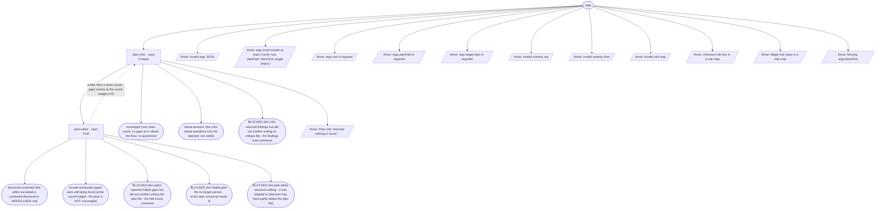

# refine-cycle flow map

Generated by `node tools/gen-flows.mjs refine`. **Do not hand-edit.**
Every node and edge below was *observed*: the scenarios in `tools/flows/` run the real engine
under the test harness with scripted agent returns, so this is what a run does rather than what
it might do. `node tools/gen-flows.mjs --check` fails the gate while this file is stale.

## Phases

| Phase | What happens |
|---|---|
| Critique | A read-only critic reads the plan file verbatim, greps the target repo, and judges every todo block against the defect bar and the severity floor. Writes plan-critique-&lt;round&gt;.md (gaps with file:line evidence, questions, and an FYI section only in a round with no gaps and no questions) and returns counts plus a wrote_file attestation, nothing else. |
| Fold | Runs only when the round returned at-or-above-floor gaps and no questions. The editor checks each gap against the plan and the repo first, folds each gap that passes into the plan file with the smallest edit that closes it, changes nothing a gap does not name, declines to DISMISSED-PLAN.md, and re-runs the plan-block tool to prove the file still parses. |

## Terminal states

| Terminal | Reached when | Source |
|---|---|---|
| converged (one clean round: no gaps at or above the floor, no questions) | the first critic finds nothing · a fold, then a clean round | derived |
| needs-answers (the critic raised questions only the operator can settle) | the critic raises a question | derived |
| dismissal-contested (the editor escalated a contested dismissal to NEEDS-USER.md) | the editor escalates a contested dismissal | derived |
| rounds-exhausted (gaps were still being found at the round budget - the plan is NOT converged) | gaps remain at the round budget | derived |
| BLOCKED (the critic returned findings but did not confirm writing its critique file - the findings exist nowhere) | the critic reports findings it did not write | derived |
| BLOCKED (the editor reported folded gaps but did not confirm writing the plan file - the fold exists nowhere) | the editor reports folds it did not write | derived |
| BLOCKED (the folded plan file no longer parses - every later consumer reads it) | the plan file stops parsing after the fold | derived |
| BLOCKED (the plan editor returned nothing - it was skipped or died and may have partly edited the plan file) | the plan editor dies | derived |
| throw: Invalid args JSON | args is a string that is not valid JSON | throw (line 29) |
| throw: args must include at least { runId, root, planPath, blockTool, target:{repo} } | args.runId is missing | throw (line 32) |
| throw: args.root is required | args.root is missing | throw (line 37) |
| throw: args.planPath is required | args.planPath is missing | throw (line 43) |
| throw: args.target.repo is required | args.target.repo is missing | throw (line 49) |
| throw: Invalid numeric arg | maxRounds is not a number | throw (line 62) |
| throw: Invalid severity floor | critiqueSeverity is outside blocking \| major \| minor | throw (line 73) |
| throw: Invalid role map | models is an array in place of an object | throw (line 91) |
| throw: Unknown role key in a role map | models carries a key outside critic \| editor | throw (line 96) |
| throw: Illegal role value in a role map | models maps a role to a model outside opus \| sonnet \| haiku \| fable · efforts maps a role to a level outside low \| medium \| high \| xhigh \| max | throw (line 99) |
| throw: Missing args.blockTool | blockTool is missing or blank | throw (line 127) |
| throw: Plan critic returned nothing in round ... | the plan critic dies | throw (line 374) |

## Coverage

22 scenarios · 2/2 roles · 12/12 throw sites · 8/8 halt statuses · 20 terminal states.
