# refine-cycle flow map

Generated by `node tools/gen-flows.mjs refine`. **Do not hand-edit.**
Every node and edge below was *observed*: the scenarios in `tools/flows/` run the real engine
under the test harness with scripted agent returns, so this is what a run does rather than what
it might do. `node tools/gen-flows.mjs --check` fails the gate while this file is stale.

```mermaid
%%{init: {"flowchart": {"nodeSpacing": 80, "rankSpacing": 200}}}%%
flowchart TD
  S0(["args"])
  a1["plan-critic · opus<br/>Critique"]
  a2["plan-editor · opus<br/>Fold"]
  t1(["converged (one clean round: no gaps at or above the floor, no questions)"])
  t2(["needs-answers (the critic or the editor raised questions only the operator can settle)"])
  t3(["dismissal-contested (the editor escalated a contested dismissal to NEEDS-USER.md)"])
  t4(["rounds-exhausted (the confirm round at the round budget found gaps, left open in the plan - the plan is NOT converged)"])
  t5(["BLOCKED (the critic did not confirm writing its critique file, which every round writes - the round has no record)"])
  t6(["BLOCKED (the editor reported folded gaps but did not confirm writing the plan file - the fold exists nowhere)"])
  t7(["BLOCKED (the folded plan file no longer parses - every later consumer reads it)"])
  t8(["BLOCKED (the plan editor returned nothing - it was skipped or died and may have partly edited the plan file)"])
  t9(["BLOCKED (the run was launched inside a user turn, so the harness relayed that message to every agent)"])
  x1[/"throw: Invalid args JSON"/]
  x2[/"throw: args must include at least { runId, root, planPath, blockTool, launchDir, target:{repo} }"/]
  x3[/"throw: args.root is required"/]
  x4[/"throw: args.planPath is required"/]
  x5[/"throw: args.target.repo is required"/]
  x6[/"throw: Invalid numeric arg"/]
  x7[/"throw: Retired arg"/]
  x8[/"throw: Invalid severity floor"/]
  x9[/"throw: Invalid role map"/]
  x10[/"throw: Unknown role key in a role map"/]
  x11[/"throw: Illegal role value in a role map"/]
  x12[/"throw: Invalid agentTypes arg"/]
  x13[/"throw: Invalid notes arg"/]
  x14[/"throw: Invalid args.conventionFiles"/]
  x15[/"throw: Missing args.launchDir"/]
  x16[/"throw: Invalid args.launchDir"/]
  x17[/"throw: Missing args.blockTool"/]
  x18[/"throw: args.notes.dir is inside the target repo"/]
  x19[/"throw: Plan critic returned nothing in round ..."/]
  S0 --> a1
  S0 --> x1
  S0 --> x2
  S0 --> x3
  S0 --> x4
  S0 --> x5
  S0 --> x6
  S0 --> x7
  S0 --> x8
  S0 --> x9
  S0 --> x10
  S0 --> x11
  S0 --> x12
  S0 --> x13
  S0 --> x14
  S0 --> x15
  S0 --> x16
  S0 --> x17
  S0 --> x18
  a1 --> a2
  a1 --> t1
  a1 --> t2
  a1 --> t4
  a1 --> t5
  a1 --> t9
  a1 --> x19
  a2 -.->|"a fold, then a clean round · the confirm round finds gaps (×4)"| a1
  a2 --> t2
  a2 --> t3
  a2 --> t6
  a2 --> t7
  a2 --> t8
```

## Phases

| Phase | What happens |
|---|---|
| Critique | A read-only critic reads the plan file verbatim, greps the target repo, and judges every todo block against the defect bar and the severity floor. Writes plan-critique-&lt;round&gt;.md every round (gaps with file:line evidence and the kind of text each is in, questions, and an FYI section only in a round with no gaps and no questions, or "No gaps." in a round with nothing) and returns counts plus a wrote_file attestation and a relayed_request flag, nothing else. |
| Fold | Runs only when the round returned at-or-above-floor gaps and no questions, and never in the launch's confirm round, its last. The editor checks each gap against the plan and the repo first, folds each gap that passes into the plan file with the smallest edit that closes it, removing wrong method text rather than correcting it, changes nothing a gap does not name, declines to DISMISSED-PLAN.md, sends a requirement gap that is the user's choice to NEEDS-USER.md, and re-runs the plan-block tool to prove the file still parses. |

## Terminal states

| Terminal | Reached when | Source |
|---|---|---|
| converged (one clean round: no gaps at or above the floor, no questions) | the first critic finds nothing · a fold, then a clean round | derived |
| needs-answers (the critic or the editor raised questions only the operator can settle) | the critic raises a question · the editor finds a requirement gap is the user's choice | derived |
| dismissal-contested (the editor escalated a contested dismissal to NEEDS-USER.md) | the editor escalates a contested dismissal | derived |
| rounds-exhausted (the confirm round at the round budget found gaps, left open in the plan - the plan is NOT converged) | the confirm round finds gaps | derived |
| BLOCKED (the critic did not confirm writing its critique file, which every round writes - the round has no record) | the critic reports findings it did not write · the critic reports a clean round it did not write | derived |
| BLOCKED (the editor reported folded gaps but did not confirm writing the plan file - the fold exists nowhere) | the editor reports folds it did not write | derived |
| BLOCKED (the folded plan file no longer parses - every later consumer reads it) | the plan file stops parsing after the fold | derived |
| BLOCKED (the plan editor returned nothing - it was skipped or died and may have partly edited the plan file) | the plan editor dies | derived |
| BLOCKED (the run was launched inside a user turn, so the harness relayed that message to every agent) | the plan critic reports a user request relayed into its context | derived |
| throw: Invalid args JSON | args is a string that is not valid JSON | throw (line 29) |
| throw: args must include at least { runId, root, planPath, blockTool, launchDir, target:{repo} } | args.runId is missing | throw (line 32) |
| throw: args.root is required | args.root is missing | throw (line 37) |
| throw: args.planPath is required | args.planPath is missing | throw (line 43) |
| throw: args.target.repo is required | args.target.repo is missing | throw (line 49) |
| throw: Invalid numeric arg | maxRounds is not a number | throw (line 62) |
| throw: Retired arg | args.priorRounds is set | throw (line 74) |
| throw: Invalid severity floor | critiqueSeverity is outside blocking \| major \| minor | throw (line 83) |
| throw: Invalid role map | models is an array in place of an object | throw (line 101) |
| throw: Unknown role key in a role map | models carries a key outside critic \| editor | throw (line 106) |
| throw: Illegal role value in a role map | models maps a role to a model outside opus \| sonnet \| haiku \| fable · efforts maps a role to a level outside low \| medium \| high \| xhigh \| max | throw (line 109) |
| throw: Invalid agentTypes arg | agentTypes is not an object, carries a key outside critic \| editor, or maps one to a blank name | throw (line 123) |
| throw: Invalid notes arg | notes lacks dir or survey, or names a relative path | throw (line 140) |
| throw: Invalid args.conventionFiles | args.conventionFiles is not an array of non-empty paths | throw (line 158) |
| throw: Missing args.launchDir | args.launchDir is missing or blank | throw (line 177) |
| throw: Invalid args.launchDir | args.launchDir is not a launch-&lt;n&gt; folder directly inside the stateDir | throw (line 193) |
| throw: Missing args.blockTool | blockTool is missing or blank | throw (line 202) |
| throw: args.notes.dir is inside the target repo | notes.dir lies inside target.repo | throw (line 232) |
| throw: Plan critic returned nothing in round ... | the plan critic dies | throw (line 526) |

## Coverage

32 scenarios · 2/2 roles · 19/19 throw sites · 9/9 halt statuses · 28 terminal states.
